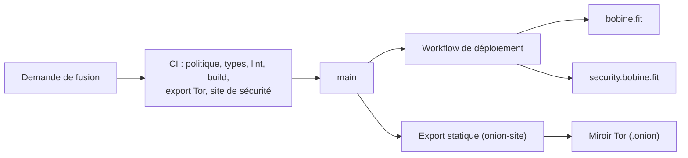

# bobine.fit

<p align="center">
  
</p>

Le site officiel de **Bobine**, régie vidéo open source, auto-hébergée et 100 % hors ligne pour salles de sport, studios de cycling et clubs de fitness : vitrine, documentation, comparatifs, guide matériel et assistant Baamix.

[](https://github.com/FantasmaGlad/BobineWeb/actions/workflows/deploy.yml)
[](https://github.com/FantasmaGlad/BobineWeb/actions/workflows/codeql.yml)


English : [README.md](README.md).

| Portail | Adresse / Dépôt |
| :--- | :--- |
| **Site principal** | <https://bobine.fit> |
| **Miroir Tor (.onion)** | `http://bobinedaoki42tt33rxacmtaab2gxvxb2orqgcyhvowv3aggxhruvrid.onion/` |
| **Portail des paquets Linux** | <https://packages.bobine.fit/fr/> *(APT, DNF, Pacman)* |
| **Portail de sécurité & divulgation** | <https://security.bobine.fit/fr/> |
| **Dépôt du logiciel Bobine** | [FantasmaGlad/Bobine](https://github.com/FantasmaGlad/Bobine) (`V5.0.7`, AGPL-3.0) |
| **Ce dépôt** | Sources du site publiées pour consultation — voir [Licence](#licence) |

---

## Constellation de l'écosystème Bobine

L'écosystème web de Bobine s'articule autour de quatre plateformes complémentaires partageant le même design system à 16 thèmes :

- **Portail principal (`bobine.fit`)** : Vitrine, documentation, guide matériel indépendant, journal des trois canaux et assistant Baamix. Réalisé avec Next.js 16 (App Router, Turbopack), React 19 et TypeScript.
- **Portail des paquets (`packages.bobine.fit`)** : Dépôts Linux officiels signés GPG (Debian/Ubuntu APT, Fedora DNF/RPM, Arch Linux Pacman) sur les trois canaux Stable, Bêta et Canary (`x86_64` et `arm64`, glibc 2.38+).
- **Portail de sécurité (`security.bobine.fit`)** : Site statique dédié, conforme RFC 9116 (`/.well-known/security.txt`), publiant la clé OpenPGP officielle (`23CA D324 C507 FB0F 97E6 AECA 6E4C 020E F8BD FEB2`) et la politique de divulgation responsable.
- **Miroir souverain Tor (`.onion`)** : Export statique de `bobine.fit` servi sur le réseau Tor sans requête externe ni lien marchand, accompagné de son dépôt APT `.onion` (`http://rzvwjat5pidtxtwzcsvew7yc5ugfjvzz432ecpn3s5mlch4cs7vvmqad.onion/`).



---

## Arborescence et pages bilingues

Toutes les pages sont servies en français (`/fr/`) et en anglais (`/en/`) depuis une source de données typée unique (`src/content/`) :

| Route (FR) | Route (EN) | Rôle |
| :--- | :--- | :--- |
| `/` | `/` | Page d'accueil, présentation de la régie fitness, grille OS et sélecteur des 16 thèmes |
| `/telechargement` | `/download` | Hub de téléchargement `V5.0.7` (Windows 11 & 10, macOS Apple Silicon, paquets Linux, Android, Android TV, CLI Bash, Tor) |
| `/linux` | `/linux` | Écosystème Linux certifié (familles Debian/Ubuntu, Fedora, Arch Linux) et configuration des dépôts |
| `/tor` | `/tor` | Miroir souverain `.onion` et guide d'installation anonyme via APT sur Tor |
| `/comparatif` | `/comparisons` | Proposition de valeur et comparatif face aux solutions fitness propriétaires et à l'affichage dynamique générique |
| `/fonctionnalites` | `/features` | Présentation structurée des fonctions de diffusion, borne adhérents, pupitre coach et radio |
| `/ressources` | `/resources` | Index alphabétique A–Z façon livre des briques open source, polices, protocoles et licences |
| `/materiel/aliexpress` | `/hardware/aliexpress` | Sélection matérielle indépendante (mini PC, tablettes, box TV, adaptateurs HDMI) |
| `/materiel/amazon` | `/hardware/amazon` | Sélection matérielle Amazon et kits régie |
| `/canaux` | `/channels` | Guide des trois canaux de publication : Stable (`V5.0.7`), Bêta et Canary |
| `/blog` | `/blog` | Notes de version des canaux Stable, Bêta et Canary lues depuis GitHub Releases |
| `/baamix` | `/baamix` | Assistant interactif ancré dans la documentation officielle et le catalogue matériel |
| `/documentation` | `/documentation` | Guide utilisateur complet, manuel d'exploitation en salle et FAQ (avec export PDF) |
| `/confidentialite` · `/mentions-legales` | `/privacy` · `/legal` | Politique de confidentialité zéro télémétrie et mentions légales |

Les anciennes routes (`/ordinateur`, `/computer`, `/google-book`, `/android-tv`, `/nouveautes`, `/whats-new`, `/securite`, `/security`) sont redirigées de façon permanente en HTTP 308 dans `next.config.ts`.

---

## Qualité et chaîne de livraison

Chaque demande de fusion et chaque déploiement exécute les contrôles automatiques suivants :

- **Politique du dépôt** (`scripts/ci/policy-check.sh`) : entrées de racine autorisées, aucun secret, aucun emoji, aucun trailer interdit.
- **Typage et build** : `npx tsc --noEmit`, ESLint et build de production Next.js.
- **Design system et contrastes** (`scripts/ci/glass-check.mjs`, `scripts/ci/check-assets.mjs`) : vérifie les 16 thèmes (8 clairs dont le thème *Charbon* noir & blanc inspiré d'Apple, 8 sombres à fort contraste) et les logos officiels sans fond.
- **Synchronisation de l'installateur** (`scripts/ci/sync-install.mjs`, `scripts/ci/check-simulator-sync.sh`) : récupère `install.sh` depuis la dernière version Stable de Bobine, vérifie son empreinte SHA-256 et contrôle la parité des étapes avec les simulateurs interactifs.
- **Miroir Tor et portail sécurité** (`scripts/ci/check-onion-export.sh`, `scripts/ci/check-security-site.sh`) : garantit l'absence de toute ressource externe dans l'export `.onion` et la validité de la signature OpenPGP de `security.txt`.

---

## Lancer le site en local

Pour lecture et relecture uniquement (voir [Licence](#licence)) :

```bash
npm ci
cp .env.example .env.local   # facultatif : le site fonctionne sans aucune clé
node scripts/ci/sync-install.mjs
npm run dev                  # http://localhost:3000
```

---

## Sécurité, Contributions & Licence

- **Sécurité** : Signalez toute vulnérabilité en privé — voir [docs/fr/SECURITY.md](docs/fr/SECURITY.md) et <https://security.bobine.fit/fr/>. Empreinte de la clé OpenPGP : `23CA D324 C507 FB0F 97E6 AECA 6E4C 020E F8BD FEB2`.
- **Contribuer** : Les signalements d'erreurs et suggestions suivent [docs/fr/CONTRIBUTING.md](docs/fr/CONTRIBUTING.md) et le [code de conduite](docs/fr/CODE_OF_CONDUCT.md).
- **Licence** : Copyright (c) 2026 Bobine. Tous droits réservés. Les sources du site sont publiées pour consultation uniquement : vous n'avez pas le droit de les copier, de les utiliser, de les modifier ni de les distribuer. Voir [LICENSE](LICENSE) et [NOTICE.md](NOTICE.md). Le logiciel Bobine est un projet distinct sous licence [GNU AGPL-3.0](https://github.com/FantasmaGlad/Bobine/blob/main/LICENSE).
