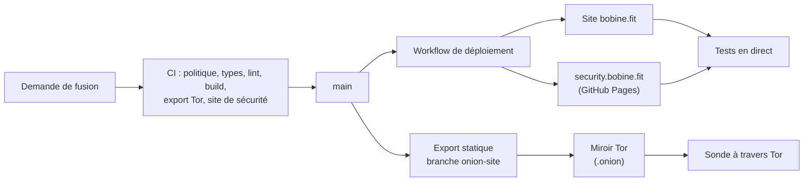

# bobine.fit

<p align="center">
  
</p>

Le site de **Bobine**, système de diffusion vidéo open source, auto-hébergé et hors ligne pour salles de sport, studios de cycling et clubs de fitness : vitrine, documentation, comparatifs, boutique matériel et assistant Baamix.

[](https://github.com/FantasmaGlad/BobineWeb/actions/workflows/deploy.yml)
[](https://github.com/FantasmaGlad/BobineWeb/actions/workflows/codeql.yml)


English: [README.md](README.md).

| | |
|---|---|
| Site | <https://bobine.fit> |
| Miroir Tor | `http://bobinedaoki42tt33rxacmtaab2gxvxb2orqgcyhvowv3aggxhruvrid.onion/` |
| Dépôt APT | <https://apt.bobine.fit> |
| Site de divulgation | <https://security.bobine.fit> |
| Logiciel | [FantasmaGlad/Bobine](https://github.com/FantasmaGlad/Bobine) (AGPL-3.0) |
| Ce dépôt | les sources du site, publiées pour être lues : voir [Licence](#licence) |

## Téléchargements du logiciel Bobine

Versions binaires officielles et modes d'installation du système de diffusion vidéo Bobine :

| Plateforme | Format | Architecture | Téléchargement direct / Commande | Profil & Fonctionnalités Clés |
| :--- | :---: | :---: | :---: | :--- |
|  | <sub>`.apk`<br>*(Paquet natif)*</sub> | <sub>ARM64<br>*(arm64-v8a)*</sub> | <sub>[**Télécharger Bobine-5.0.2.apk**](https://github.com/FantasmaGlad/Bobine/releases/download/V5.0.2/Bobine-5.0.2.apk)</sub> | **Tablettes Android, Google Books & Bornes ARM**<br><sub>Pupitre coach tactile (`/grid`) + grand écran HDMI (`/cinema`), Google Books via APK (et bientôt Google Play Store natif)</sub> |
|  | <sub>`.apk`<br>*(Paquet TV dédié)*</sub> | <sub>ARM 32 & 64 bits<br>*(armeabi-v7a, arm64-v8a)*</sub> | <sub>[**Télécharger Bobine-TV-5.0.2.apk**](https://github.com/FantasmaGlad/Bobine/releases/download/V5.0.2/Bobine-TV-5.0.2.apk)</sub> | **Android TV & Google TV**<br><sub>Bannière Leanback TV, navigation télécommande D-Pad, mode autonome</sub> |
|  | <sub>`.exe`<br>*(Installeur)*</sub> | <sub>x86-64 & ARM64<br>*(Snapdragon)*</sub> | <sub>[**Bobine-Setup-5.0.2.exe (x86-64)**](https://github.com/FantasmaGlad/Bobine/releases/download/V5.0.2/Bobine-Setup-5.0.2.exe)<br>[**Bobine-Setup-5.0.2-arm64.exe (ARM64)**](https://github.com/FantasmaGlad/Bobine/releases/download/V5.0.2/Bobine-Setup-5.0.2-arm64.exe)</sub> | **PC Windows x86-64 & Windows ARM (Snapdragon)**<br><sub>Installeur natif x86-64 et ARM64 (Snapdragon X Elite / X Plus), mode clamshell</sub> |
| [](https://www.debian.org/) [](https://ubuntu.com/)<br>[](https://linuxmint.com/) [](https://system76.com/pop)<br>[](https://zorin.com/os/) | <sub>`.deb`<br>APT</sub> | <sub>x86-64 (`amd64`)<br>ARM64 (`arm64`)</sub> | <sub>[**Dépôt APT**](https://apt.bobine.fit)<br>[**bobine_5.0.2_amd64.deb**](https://github.com/FantasmaGlad/Bobine/releases/download/V5.0.2/bobine_5.0.2_amd64.deb)<br>[**bobine_5.0.2_arm64.deb**](https://github.com/FantasmaGlad/Bobine/releases/download/V5.0.2/bobine_5.0.2_arm64.deb)</sub> | **Debian, Ubuntu et dérivés**<br><sub>Paquets disponibles. Linux Mint (Ubuntu ou LMDE), Pop!_OS et Zorin OS : utiliser le paquet de la famille APT si les dépendances sont satisfaites ; validation individuelle encore requise.</sub> |
| [](https://fedoraproject.org/) [](https://nobaraproject.org/) | <sub>`.rpm`<br>DNF</sub> | <sub>x86-64 (`x86_64`)<br>ARM64 (`aarch64`)<br>cibles prévues</sub> | <sub>**En préparation**<br>[**Suivi du dépôt RPM**](https://github.com/FantasmaGlad/bobine-rpm)</sub> | **Fedora / Nobara**<br><sub>Intégration des paquets et du dépôt signés en cours. Nobara est un dérivé Fedora ; aucune validation matérielle Fedora/Nobara à ce stade.</sub> |
| [](https://archlinux.org/) [](https://endeavouros.com/)<br>[](https://cachyos.org/) [](https://manjaro.org/) | <sub>`.pkg.tar.zst`<br>pacman</sub> | <sub>x86-64 (`x86_64`)<br>ARM64 (`aarch64`)<br>cibles prévues</sub> | <sub>**En préparation**<br>[**Suivi du dépôt Arch**](https://github.com/FantasmaGlad/bobine-arch)</sub> | **Arch Linux / dérivés**<br><sub>Intégration des paquets et du dépôt signés en cours. EndeavourOS et CachyOS : cibles dérivées à valider. Manjaro : compatibilité à vérifier séparément, ses dépôts ayant leur propre cadence.</sub> |
|  | <sub>`.dmg`<br>*(Image disque)*</sub> | <sub>Apple Silicon<br>*(arm64)*</sub> | <sub>[**Télécharger Bobine-5.0.2.dmg**](https://github.com/FantasmaGlad/Bobine/releases/download/V5.0.2/Bobine-5.0.2.dmg)</sub> | **MacBook, Mac mini & iMac**<br><sub>Glisser-déposer `.dmg`, Apple Silicon, barre de menus</sub> |
|  | <sub>App iPadOS<br>*(Piste explorée)*</sub> | <sub>ARM64 (Apple Silicon)</sub> | <sub>*Piste explorée...*</sub> | **iPads & Tablettes Apple (Piste explorée)**<br><sub>Prototype pupitre coach avec sortie vidéo USB-C / Thunderbolt</sub> |
|  | <sub>Binaire natif<br>*(Tauri 2)*</sub> | <sub>x86-64 & ARM64<br>*(Linux)*</sub> | <sub>[**bobine-assistant (x86-64)**](https://github.com/FantasmaGlad/Bobine/releases/download/V5.0.2/bobine-assistant)<br>[**bobine-assistant-arm64 (ARM64)**](https://github.com/FantasmaGlad/Bobine/releases/download/V5.0.2/bobine-assistant-arm64)</sub> | **Assistant Graphique de Déploiement**<br><sub>Découverte réseau locale, audit matériel et déploiement SSH</sub> |
|  | <sub>Script Shell<br>*(Automatisé)*</sub> | <sub>x86-64 & ARM64</sub> | <sub>`curl -sSL https://bobine.fit/install.sh \| bash`</sub> | **Appliance Dédiée Headless**<br><sub>Installation automatisée sur mini-PC et stations ARM64 (Debian 13)</sub> |
| [](http://bobinedaoki42tt33rxacmtaab2gxvxb2orqgcyhvowv3aggxhruvrid.onion/) | <sub>Dépôt APT & Miroir<br>*(Réseau Tor)*</sub> | <sub>x86-64 & ARM64</sub> | <sub>`curl -fsSL https://bobine.fit/install-tor.sh \| bash`<br>[**Site miroir .onion**](http://bobinedaoki42tt33rxacmtaab2gxvxb2orqgcyhvowv3aggxhruvrid.onion/)<br>[**Dépôt APT .onion**](http://rzvwjat5pidtxtwzcsvew7yc5ugfjvzz432ecpn3s5mlch4cs7vvmqad.onion/)</sub> | **Distribution Tor (.onion)**<br><sub>Dépôt APT anonyme (suites Stable, Bêta et Canary, canal choisi avec `--channel`) et miroir sans exposition d'adresse IP</sub> |
| [](https://bobine.fit) | <sub>Portail Web</sub> | <sub>Universel</sub> | <sub>[**Visiter bobine.fit**](https://bobine.fit)</sub> | **Site Officiel & Documentation**<br><sub>Guides de prise en main, conseils matériel et base de connaissances</sub> |
|  | <sub>Binaires & Sources</sub> | <sub>Multi-OS</sub> | <sub>[**Voir les Releases GitHub**](https://github.com/FantasmaGlad/Bobine/releases/latest)</sub> | **Releases & Code Source**<br><sub>Sommes de contrôle SHA-256 certifiées, archives et historique</sub> |

### Distributions Linux : périmètre de prise en charge

Les logos renvoient aux sites officiels des distributions. Les liens APT donnent accès aux paquets disponibles ; les liens RPM et Arch ouvrent le suivi de leur mise en service. Les distributions d’une même famille partagent un format de paquet, mais cela ne garantit pas toutes les versions, dépendances, architectures ou configurations matérielles. Une distribution dérivée citée ci-dessus n’est pas automatiquement validée pour Bobine.

[](https://www.redhat.com/en/technologies/linux-platforms/enterprise-linux) [](https://almalinux.org/) [](https://rockylinux.org/)

RHEL, AlmaLinux et Rocky Linux sont des systèmes de la famille RPM à évaluer séparément : la compatibilité du paquet Fedora n’est pas établie, et l’ajout d’EPEL ne suffit pas à la garantir. Les éditions immuables (Silverblue, Kinoite, Bazzite) nécessitent une méthode dédiée qui n’est pas fournie ici. Le script d’installation de l’appliance kiosque reste destiné à **Debian 13** ; le support des paquets de bureau ne l’étend pas aux autres distributions. Les binaires ARM64 exigent un système ARM64 et n’impliquent pas que chaque dérivé propose cette architecture.

## Points forts

- **Deux langues, une seule source.** Les pages françaises et anglaises partagent une source de contenu unique (`src/content/docs/`) qui alimente la documentation, la FAQ, le PDF téléchargeable et l'assistant : une information s'écrit une seule fois.
- **Design system à 16 thèmes** (8 clairs, 8 sombres), unifiés avec l'application Bobine en variables CSS pures, calibrés pour les contrastes WCAG AA et AAA, avec des animations d'interface qui respectent `prefers-reduced-motion`.
- **Un verre translucide construit par jetons.** Chaque flou et chaque surface de verre vient de variables (`--blur-*`, `--glass-*`, dont `--glass-modal-bg` pour la fenêtre de téléchargement), avec un mode `prefers-reduced-transparency` ; `scripts/ci/glass-check.mjs` fait échouer la chaîne sur une valeur figée, une variable non définie ou un contraste de texte insuffisant dans l'un des 16 thèmes.
- **Trois canaux de mise à jour partout.** Stable, Bêta et Canary se choisissent dans la fenêtre de téléchargement, sur chaque page de référencement (carte de téléchargement adaptée à l'appareil), dans les installateurs shell (`install.sh --channel=stable|beta|canary`, et `install-tor.sh --channel=stable|beta|canary` avec une question interactive sur un terminal) et dans les deux simulateurs d'installation (shell, dont un mode Tor qui demande le canal, et assistant Tauri avec ses trois cartes de canal).
- **Un miroir Tor construit depuis le même code.** Le site est exporté en statique et servi comme service onion v3, à côté d'un dépôt APT qui publie les trois suites (`stable`, `beta`, `canary`). La construction retire toutes les routes serveur et fait échouer la chaîne si un lien marchand, une ressource externe ou un script de mesure s'y glisse.
- **Baamix**, un assistant qui répond sur l'installation et le choix du matériel. Ses fiches produit viennent du vrai catalogue, jamais du texte du modèle.
- **Une boutique matériel avec panier en direct**, des catalogues d'affiliation Amazon et AliExpress, et un seul endroit pour chaque prix et chaque identifiant.
- **Une posture de sécurité vérifiable.** Un `security.txt` signé OpenPGP ([RFC 9116](https://www.rfc-editor.org/rfc/rfc9116)), une clé de réception des rapports dont l'empreinte est contrôlée chaque jour sur quatre canaux indépendants, et un site de divulgation hébergé séparément du site.
- **Une chaîne de livraison conduite par GitHub Actions** : validation, déploiement et tests en direct forment un seul workflow, et l'intégration Git de l'hébergeur est désactivée.

## Architecture



| Domaine | Choix |
|---|---|
| Framework | Next.js 16 (App Router, Turbopack), React 19, TypeScript |
| Contenu | Modules de données typés (`src/content/`), notes de version lues sur GitHub Releases ; export PDF avec `@react-pdf/renderer` |
| Style | CSS pur à variables, aucun framework d'interface |
| Assistant | Route serveur avec repli entre fournisseurs ; catalogue résolu côté serveur |
| Hébergement | Vercel derrière Cloudflare, déployé par GitHub Actions ; miroir Tor sur une machine auto-hébergée |

## Qualité et livraison

Rien n'est publié sans passer par le workflow de validation, qui contrôle à chaque demande de fusion :

- la politique du dépôt : seules des entrées de racine autorisées, aucun secret, aucun emoji, aucun trailer interdit ;
- `tsc --noEmit`, ESLint et le build de production ;
- les jetons de verre et de style, et le contraste du texte sur chaque matériau de verre des 16 thèmes (`glass-check.mjs`) ;
- les simulateurs d'installation face aux scripts publiés (`check-simulator-sync.sh` : mêmes titres d'étapes, mêmes trois canaux) ;
- l'export statique du miroir Tor et ses garanties (aucune ressource externe, aucun lien marchand, aucun script de mesure), ShellCheck sur les scripts shell, et l'identité de `public/install-tor.sh` avec sa copie de déploiement ;
- le site de sécurité : signature de `security.txt`, empreinte, expirations, liens locaux (`check-security-site.sh`).

Après publication, des tests en direct interrogent le vrai site, le site de divulgation et le service onion à travers Tor. CodeQL, un contrôle quotidien de l'empreinte OpenPGP et un contrôle quotidien de cohérence avec les releases de Bobine (`check-release-sync.sh` : `install.sh` identique à celui du logiciel, fichiers de téléchargement présents pour Stable, Bêta et Canary) tournent en continu.

## Le lancer en local

Pour lire et relire seulement : la [licence](#licence) n'accorde pas le droit d'utiliser ni de déployer ce code.

```bash
npm ci
cp .env.example .env.local   # facultatif : le site fonctionne sans aucune clé
npm run dev                  # http://localhost:3000
```

## Sécurité

Signalez les vulnérabilités en privé, jamais par ticket public : voir [SECURITY.md](docs/fr/SECURITY.md) et <https://bobine.fit/fr/securite>. L'empreinte de la clé de réception est `23CA D324 C507 FB0F 97E6 AECA 6E4C 020E F8BD FEB2`.

## Contribuer

Les signalements d'erreurs et les suggestions sont bienvenus sous forme de tickets ; les contributions de code suivent [CONTRIBUTING.md](docs/fr/CONTRIBUTING.md) et le [code de conduite](docs/fr/CODE_OF_CONDUCT.md). Les contributions sont cédées à Bobine, comme expliqué dans ce guide.

## Licence

Copyright (c) 2026 Bobine. Tous droits réservés. Les sources sont publiées pour être lues uniquement : vous n'avez pas le droit de les copier, de les utiliser, de les modifier ni de les distribuer. Voir [LICENSE](LICENSE) et [NOTICE.md](NOTICE.md) pour les éléments tiers. Le logiciel Bobine est un projet distinct sous GNU AGPL-3.0.
