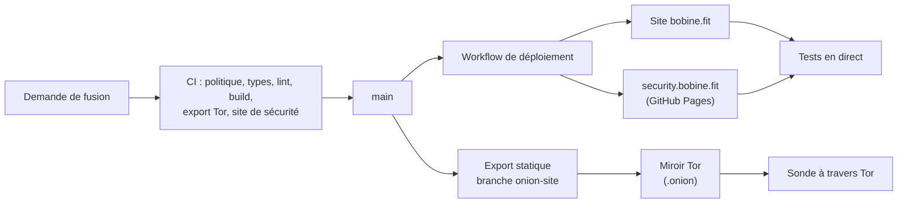

# bobine.fit

Le site de **Bobine**, système de diffusion vidéo open source, auto-hébergé et hors ligne pour salles de sport, studios de cycling et clubs de fitness : vitrine, documentation, comparatifs, boutique matériel et assistant Baamix.

[](https://github.com/FantasmaGlad/BobineWeb/actions/workflows/deploy.yml)
[](https://github.com/FantasmaGlad/BobineWeb/actions/workflows/codeql.yml)


English: [README.md](README.md).

| | |
|---|---|
| Site | <https://bobine.fit> |
| Miroir Tor | `http://bobinedaoki42tt33rxacmtaab2gxvxb2orqgcyhvowv3aggxhruvrid.onion/` |
| Dépôt APT | <https://apt.bobine.fit> |
| Site de divulgation | <https://security.bobine.fit> |
| Logiciel | [FantasmaGlad/Bobine](https://github.com/FantasmaGlad/Bobine) (AGPL-3.0) |
| Ce dépôt | les sources du site, publiées pour être lues : voir [Licence](#licence) |

## Points forts

- **Deux langues, une seule source.** Les pages françaises et anglaises partagent une source de contenu unique (`src/content/docs/`) qui alimente la documentation, la FAQ, le PDF téléchargeable et l'assistant : une information s'écrit une seule fois.
- **Design system à 17 thèmes** (8 clairs, 9 sombres), en variables CSS pures, calibré pour les contrastes WCAG AA et AAA, avec des animations d'interface qui respectent `prefers-reduced-motion`.
- **3D interactive** avec Three.js et React Three Fiber, avec des décodeurs servis localement pour ne contacter aucun tiers.
- **Un miroir Tor construit depuis le même code.** Le site est exporté en statique et servi comme service onion v3, à côté d'un dépôt APT. La construction retire toutes les routes serveur et fait échouer la chaîne si un lien marchand, une ressource externe ou un script de mesure s'y glisse.
- **Baamix**, un assistant qui répond sur l'installation et le choix du matériel. Ses fiches produit viennent du vrai catalogue, jamais du texte du modèle.
- **Une boutique matériel avec panier en direct**, des catalogues d'affiliation Amazon et AliExpress, et un seul endroit pour chaque prix et chaque identifiant.
- **Une posture de sécurité vérifiable.** Un `security.txt` signé OpenPGP ([RFC 9116](https://www.rfc-editor.org/rfc/rfc9116)), une clé de réception des rapports dont l'empreinte est contrôlée chaque jour sur quatre canaux indépendants, et un site de divulgation hébergé séparément du site.
- **Une chaîne de livraison conduite par GitHub Actions** : validation, déploiement et tests en direct forment un seul workflow, et l'intégration Git de l'hébergeur est désactivée.

## Architecture



| Domaine | Choix |
|---|---|
| Framework | Next.js 16 (App Router, Turbopack), React 19, TypeScript |
| Contenu | MDX et modules de données typés ; export PDF avec `@react-pdf/renderer` |
| Style | CSS pur à variables, aucun framework d'interface |
| 3D | Three.js, React Three Fiber, Drei |
| Assistant | Route serveur avec repli entre fournisseurs ; catalogue résolu côté serveur |
| Hébergement | Vercel derrière Cloudflare, déployé par GitHub Actions ; miroir Tor sur une machine auto-hébergée |

## Qualité et livraison

Rien n'est publié sans passer par le workflow de validation, qui contrôle à chaque demande de fusion :

- la politique du dépôt : seules des entrées de racine autorisées, aucun secret, aucun emoji, aucun trailer interdit ;
- `tsc --noEmit`, ESLint et le build de production ;
- l'export statique du miroir Tor et ses garanties (aucune ressource externe, aucun lien marchand, aucun script de mesure) ;
- le site de sécurité : signature de `security.txt`, empreinte, expirations, liens locaux.

Après publication, des tests en direct interrogent le vrai site, le site de divulgation et le service onion à travers Tor. CodeQL et un contrôle quotidien de l'empreinte OpenPGP tournent en continu. Détails : [`docs/DEVELOPPEMENT.md`](docs/DEVELOPPEMENT.md).

## Le lancer en local

Pour lire et relire seulement : la [licence](#licence) n'accorde pas le droit d'utiliser ni de déployer ce code.

```bash
npm ci
cp .env.example .env.local   # facultatif : le site fonctionne sans aucune clé
npm run dev                  # http://localhost:3000
```

## Sécurité

Signalez les vulnérabilités en privé, jamais par ticket public : voir [SECURITY.md](docs/fr/SECURITY.md) et <https://bobine.fit/fr/securite>. L'empreinte de la clé de réception est `23CA D324 C507 FB0F 97E6 AECA 6E4C 020E F8BD FEB2`.

## Contribuer

Les signalements d'erreurs et les suggestions sont bienvenus sous forme de tickets ; les contributions de code suivent [CONTRIBUTING.md](docs/fr/CONTRIBUTING.md) et le [code de conduite](docs/fr/CODE_OF_CONDUCT.md). Les contributions sont cédées à Bobine, comme expliqué dans ce guide.

## Licence

Copyright (c) 2026 Bobine. Tous droits réservés. Les sources sont publiées pour être lues uniquement : vous n'avez pas le droit de les copier, de les utiliser, de les modifier ni de les distribuer. Voir [LICENSE](LICENSE) et [NOTICE.md](NOTICE.md) pour les éléments tiers. Le logiciel Bobine est un projet distinct sous GNU AGPL-3.0.
