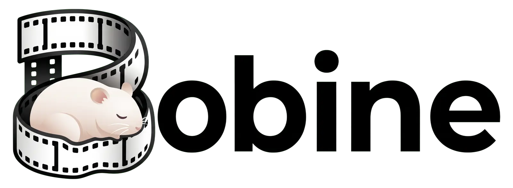
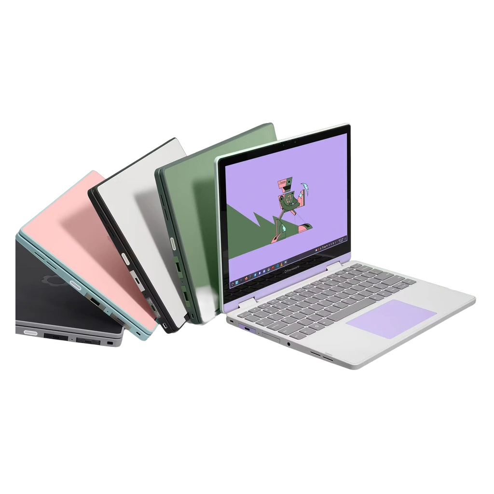
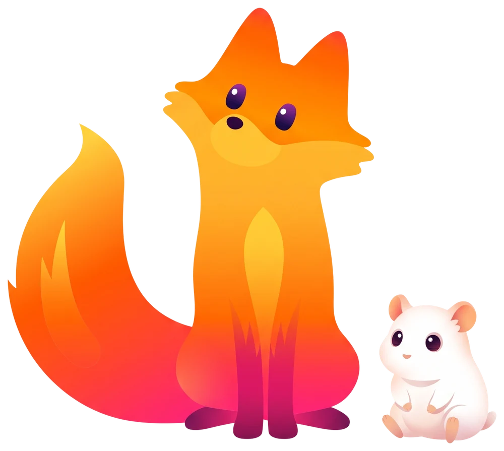
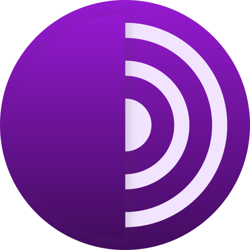
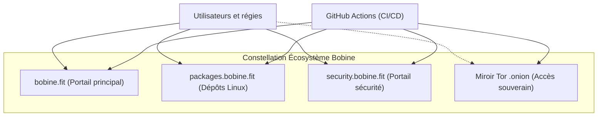
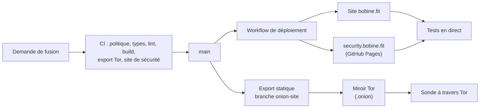

# bobine.fit

<p align="center">
  
</p>

<table align="center">
  <tr>
    <td align="center" valign="middle"><a href="https://frame.work/"></a></td>
    <td align="center" valign="middle"><a href="https://www.mozilla.org/fr/firefox/"></a></td>
  </tr>
</table>

<p align="center">
  <b>Compatibilité multi-OS certifiée & ordinateurs portables modulaires <a href="https://frame.work/">Framework Laptop</a>.</b><br>
  <sub>Écosystème modulaire réparable <a href="https://frame.work/">Framework Laptop</a> (AMD Ryzen, Intel Core Ultra, Qualcomm Snapdragon X ARM), dépôts Linux officiels sur <a href="https://packages.bobine.fit">packages.bobine.fit</a> et validation Firefox 157. <a href="https://frame.work/">Découvrir Framework</a> &nbsp;·&nbsp; <a href="https://packages.bobine.fit">Dépôts Linux</a></sub>
</p>

<p align="center">
  <sub>#video #streaming #fitness #gym #digital-signage #media-player #self-hosted #open-source #automation #kiosk #offline-first #nextjs #rust #tauri #linux #cross-platform #display #appliance #framework</sub>
</p>

Le site de **Bobine**, système de diffusion vidéo open source, auto-hébergé et hors ligne pour salles de sport, studios de cycling et clubs de fitness : vitrine, documentation, comparatifs, boutique matériel et assistant Baamix.

[](https://github.com/FantasmaGlad/BobineWeb/actions/workflows/deploy.yml)
[](https://github.com/FantasmaGlad/BobineWeb/actions/workflows/codeql.yml)


English: [README.md](README.md).

| | |
|---|---|
| Site | <https://bobine.fit> |
| Miroir Tor | `http://bobinedaoki42tt33rxacmtaab2gxvxb2orqgcyhvowv3aggxhruvrid.onion/` |
| Dépôts Linux (APT, DNF, Pacman) | <https://packages.bobine.fit> |
| Site de divulgation | <https://security.bobine.fit> |
| Logiciel | [FantasmaGlad/Bobine](https://github.com/FantasmaGlad/Bobine) (AGPL-3.0) |
| Ce dépôt | les sources du site, publiées pour être lues : voir [Licence](#licence) |

## Téléchargements du logiciel Bobine

Versions binaires officielles et modes d'installation du système de diffusion vidéo Bobine :

| Plateforme | Format | Architecture | Téléchargement direct / Commande | Profil & Fonctionnalités Clés |
| :--- | :---: | :---: | :---: | :--- |
|  | <sub>`.apk`<br>*(Paquet natif)*</sub> | <sub>ARM64<br>*(arm64-v8a)*</sub> | <sub>[**Télécharger Bobine-5.0.7.apk**](https://github.com/FantasmaGlad/Bobine/releases/download/V5.0.7/Bobine-5.0.7.apk)</sub> | **Tablettes Android, Google Books & Bornes ARM**<br><sub>Pupitre coach tactile (`/grid`) + grand écran HDMI (`/cinema`), Google Books via APK (et bientôt Google Play Store natif)</sub> |
|  | <sub>`.apk`<br>*(Paquet TV dédié)*</sub> | <sub>ARM 32 & 64 bits<br>*(armeabi-v7a, arm64-v8a)*</sub> | <sub>[**Télécharger Bobine-TV-5.0.7.apk**](https://github.com/FantasmaGlad/Bobine/releases/download/V5.0.7/Bobine-TV-5.0.7.apk)</sub> | **Android TV & Google TV**<br><sub>Bannière Leanback TV, navigation télécommande D-Pad, mode autonome</sub> |
|  | <sub>`.exe`<br>*(Installeur)*</sub> | <sub>x86-64 & ARM64<br>*(Snapdragon)*</sub> | <sub>[**Bobine-Setup-5.0.7.exe (x86-64)**](https://github.com/FantasmaGlad/Bobine/releases/download/V5.0.7/Bobine-Setup-5.0.7.exe)<br>[**Bobine-Setup-5.0.7-arm64.exe (ARM64)**](https://github.com/FantasmaGlad/Bobine/releases/download/V5.0.7/Bobine-Setup-5.0.7-arm64.exe)</sub> | **PC Windows x86-64 & Windows ARM (Snapdragon)**<br><sub>Installeur natif x86-64 et ARM64 (Snapdragon X Elite / X Plus), mode clamshell</sub> |
| [](https://www.debian.org/) [](https://ubuntu.com/)<br>[](https://linuxmint.com/) [](https://system76.com/pop)<br>[](https://zorin.com/os/) | <sub>`.deb`<br>APT</sub> | <sub>x86-64 (`amd64`)<br>ARM64 (`arm64`)</sub> | <sub>[**Dépôt APT**](https://packages.bobine.fit/debian/)<br>[**bobine_5.0.7_amd64.deb**](https://github.com/FantasmaGlad/Bobine/releases/download/V5.0.7/bobine_5.0.7_amd64.deb)<br>[**bobine_5.0.7_arm64.deb**](https://github.com/FantasmaGlad/Bobine/releases/download/V5.0.7/bobine_5.0.7_arm64.deb)</sub> | **Debian, Ubuntu et dérivés**<br><sub>Paquets disponibles via [packages.bobine.fit/debian/](https://packages.bobine.fit/debian/). Prise en charge native amd64 et arm64 avec mises à jour automatiques via apt.</sub> |
| [](https://fedoraproject.org/) [](https://nobaraproject.org/) | <sub>`.rpm`<br>DNF</sub> | <sub>x86-64 (`x86_64`)<br>ARM64 (`aarch64`)</sub> | <sub>[**Dépôt DNF**](https://packages.bobine.fit/fedora/)<br>[**bobine-5.0.7-1.x86_64.rpm**](https://github.com/FantasmaGlad/Bobine/releases/download/V5.0.7/bobine-5.0.7-1.x86_64.rpm)<br>[**bobine-5.0.7-1.aarch64.rpm**](https://github.com/FantasmaGlad/Bobine/releases/download/V5.0.7/bobine-5.0.7-1.aarch64.rpm)</sub> | **Fedora, Nobara et dérivés RPM**<br><sub>Paquets disponibles via [packages.bobine.fit/fedora/](https://packages.bobine.fit/fedora/). Dépôt DNF signé avec clé GPG officielle, installation en 1 commande \`sudo dnf install bobine\`.</sub> |
| [](https://archlinux.org/) [](https://endeavouros.com/)<br>[](https://cachyos.org/) [](https://manjaro.org/) | <sub>`.pkg.tar.zst`<br>pacman</sub> | <sub>x86-64 (`x86_64`)<br>ARM64 (`aarch64`)</sub> | <sub>[**Dépôt Pacman**](https://packages.bobine.fit/arch/)<br>[**bobine-5.0.7-1-x86_64.pkg.tar.zst**](https://github.com/FantasmaGlad/Bobine/releases/download/V5.0.7/bobine-5.0.7-1-x86_64.pkg.tar.zst)<br>[**bobine-5.0.7-1-aarch64.pkg.tar.zst**](https://github.com/FantasmaGlad/Bobine/releases/download/V5.0.7/bobine-5.0.7-1-aarch64.pkg.tar.zst)</sub> | **Arch Linux, EndeavourOS, CachyOS et dérivés**<br><sub>Paquets disponibles via [packages.bobine.fit/arch/](https://packages.bobine.fit/arch/). Base de données de dépôt signée, synchronisation et mise à jour continue via \`pacman -Syu bobine\`.</sub> |
|  | <sub>`.dmg`<br>*(Image disque)*</sub> | <sub>Apple Silicon<br>*(arm64)*</sub> | <sub>[**Télécharger Bobine-5.0.7.dmg**](https://github.com/FantasmaGlad/Bobine/releases/download/V5.0.7/Bobine-5.0.7.dmg)</sub> | **MacBook, Mac mini & iMac**<br><sub>Glisser-déposer `.dmg`, Apple Silicon, barre de menus</sub> |
|  | <sub>App iPadOS<br>*(Piste explorée)*</sub> | <sub>ARM64 (Apple Silicon)</sub> | <sub>*Piste explorée...*</sub> | **iPads & Tablettes Apple (Piste explorée)**<br><sub>Prototype pupitre coach avec sortie vidéo USB-C / Thunderbolt</sub> |
|  | <sub>Binaire natif<br>*(Tauri 2)*</sub> | <sub>x86-64 & ARM64<br>*(Linux)*</sub> | <sub>[**bobine-assistant (x86-64)**](https://github.com/FantasmaGlad/Bobine/releases/download/V5.0.7/bobine-assistant)<br>[**bobine-assistant-arm64 (ARM64)**](https://github.com/FantasmaGlad/Bobine/releases/download/V5.0.7/bobine-assistant-arm64)</sub> | **Assistant Graphique de Déploiement**<br><sub>Découverte réseau locale, audit matériel et déploiement SSH</sub> |
|  | <sub>Script Shell<br>*(Automatisé)*</sub> | <sub>x86-64 & ARM64</sub> | <sub>`curl -sSL https://bobine.fit/install.sh \| bash`</sub> | **Appliance Dédiée Headless**<br><sub>Installation automatisée sur mini-PC et stations ARM64 (Debian 13)</sub> |
| [](http://bobinedaoki42tt33rxacmtaab2gxvxb2orqgcyhvowv3aggxhruvrid.onion/) | <sub>Dépôt APT & Miroir<br>*(Réseau Tor)*</sub> | <sub>x86-64 & ARM64</sub> | <sub>`curl -fsSL https://bobine.fit/install-tor.sh \| bash`<br>[**Site miroir .onion**](http://bobinedaoki42tt33rxacmtaab2gxvxb2orqgcyhvowv3aggxhruvrid.onion/)<br>[**Dépôt APT .onion**](http://rzvwjat5pidtxtwzcsvew7yc5ugfjvzz432ecpn3s5mlch4cs7vvmqad.onion/)</sub> | **Distribution Tor (.onion)**<br><sub>Dépôt APT anonyme (suites Stable, Bêta et Canary, canal choisi avec `--channel`) et miroir sans exposition d'adresse IP</sub> |
| [](https://bobine.fit) | <sub>Portail Web</sub> | <sub>Universel</sub> | <sub>[**Visiter bobine.fit**](https://bobine.fit)</sub> | **Site Officiel & Documentation**<br><sub>Guides de prise en main, conseils matériel et base de connaissances</sub> |
|  | <sub>Binaires & Sources</sub> | <sub>Multi-OS</sub> | <sub>[**Voir les Releases GitHub**](https://github.com/FantasmaGlad/Bobine/releases/latest)</sub> | **Releases & Code Source**<br><sub>Sommes de contrôle SHA-256 certifiées, archives et historique</sub> |

### Distributions Linux : périmètre de prise en charge & écosystème

Bobine fournit des paquets natifs pour les familles Debian, Fedora et Arch Linux. Les binaires embarqués exigent **glibc 2.38 ou plus récente** : Debian 13 et Ubuntu 24.04 LTS ou plus récent (et les distributions qui en dérivent), Fedora et Arch Linux à jour. Debian 12, Ubuntu 22.04 LTS et RHEL 9 et compatibles ne sont pas pris en charge (glibc plus ancienne). La CI installe les paquets sur Ubuntu 24.04 (x86-64 et ARM64), Fedora (x86-64) et Arch Linux (x86-64) ; les autres distributions ci-dessous utilisent les mêmes paquets et ne sont pas testées séparément. Cliquez sur un logo ou son nom pour accéder au site officiel de chaque projet :

#### 1. Famille Debian & Dérivés (Paquets `.deb` & Dépôt APT sur [packages.bobine.fit/debian/](https://packages.bobine.fit/debian/))
| Distribution | Statut & Rôle | Site officiel |
| :--- | :--- | :---: |
|  **Debian** | Système de référence pour l'appliance autonome Bobine. Paquet `.deb` : Debian 13 Trixie ou plus récent (Debian 12 Bookworm n'est pas pris en charge : glibc 2.36) | [debian.org](https://www.debian.org/) |
|  **Ubuntu** | Installation testée en CI sur 24.04 LTS (x86_64 et ARM64) ; 22.04 LTS n'est pas prise en charge (glibc 2.35) | [ubuntu.com](https://ubuntu.com/) |
|  **Linux Mint** | Éditions Cinnamon / MATE / Xfce basées sur Ubuntu 24.04 ou plus récent, et LMDE basée sur Debian 13 ou plus récent (même `.deb`, non testées séparément) | [linuxmint.com](https://linuxmint.com/) |
|  **Pop!_OS** | Éditions COSMIC / GNOME basées sur Ubuntu 24.04 ou plus récent, avec GPU commutable (même `.deb`, non testées séparément) | [system76.com/pop](https://system76.com/pop/) |
|  **Zorin OS** | Interface studio intuitive pour postes de régie et PC d'accueil (versions basées sur Ubuntu 24.04 ou plus récent ; même `.deb`, non testées séparément) | [zorin.com/os](https://zorin.com/os/) |
|  **Raspberry Pi OS** | Raspberry Pi 5 ARM64 (8 Go / 16 Go) sur les images basées sur Debian 13 ou plus récent ; les images Bookworm ne sont pas prises en charge (glibc 2.36). Le `.deb` ARM64 est testé en CI sur Ubuntu 24.04, pas sur un Raspberry Pi | [raspberrypi.com](https://www.raspberrypi.com/software/) |

#### 2. Famille Fedora & Dérivés RPM (Paquets `.rpm` & Dépôt DNF sur [packages.bobine.fit/fedora/](https://packages.bobine.fit/fedora/))
| Distribution | Statut & Rôle | Site officiel |
| :--- | :--- | :---: |
|  **Fedora** | Cible principale de la famille RPM (Workstation & Server) : installation testée en CI sur x86_64 ; le paquet aarch64 est construit et contrôlé mais pas installé en CI | [fedoraproject.org](https://fedoraproject.org/) |
|  **Nobara Linux** | Base Fedora optimisée avec pilotes multimédias et VA-API préconfigurés (même `.rpm`, non testée séparément) | [nobaraproject.org](https://nobaraproject.org/) |
|  **RHEL** | Postes et serveurs d'entreprise (via EPEL et RPM Fusion) : version 10 ou plus récente uniquement, RHEL 9 n'est pas pris en charge (glibc 2.34) ; non couvert par la CI | [redhat.com](https://www.redhat.com/) |
|  **AlmaLinux** | Dérivé RHEL binaire 100% compatible : version 10 ou plus récente uniquement (AlmaLinux 9 n'est pas pris en charge) ; non couvert par la CI | [almalinux.org](https://almalinux.org/) |
|  **Rocky Linux** | Distribution communautaire pérenne pour serveurs et régies : version 10 ou plus récente uniquement (Rocky Linux 9 n'est pas prise en charge) ; non couverte par la CI | [rockylinux.org](https://rockylinux.org/) |
|  **openSUSE** | Pas encore pris en charge officiellement : ni dépôt ni couverture CI (le `.rpm` est construit et testé sur Fedora) | [opensuse.org](https://www.opensuse.org/) |

#### 3. Famille Arch Linux & Dérivés (Paquets `.pkg.tar.zst` & Dépôt Pacman sur [packages.bobine.fit/arch/](https://packages.bobine.fit/arch/))
| Distribution | Statut & Rôle | Site officiel |
| :--- | :--- | :---: |
|  **Arch Linux** | Système rolling-release de pointe (x86_64 & Arch Linux ARM aarch64) | [archlinux.org](https://archlinux.org/) |
|  **EndeavourOS** | Base Arch avec installeur Calamares pour postes de travail | [endeavouros.com](https://endeavouros.com/) |
|  **CachyOS** | Noyau optimisé x86-64-v3/v4 et ordonnanceur BORE ultra-réactif | [cachyos.org](https://cachyos.org/) |
|  **Manjaro Linux** | Distribution grand public avec cycle de release stabilisé | [manjaro.org](https://manjaro.org/) |

#### 4. Systèmes d'Exploitation & Appareils Compatibles Recommandés

> [!NOTE]
> **Indépendance des recommandations & Boutique matérielle** : Bobine n'a **aucun partenariat commercial, sponsoring ou contrat de marque** avec les constructeurs : ce sont des recommandations matérielles strictement indépendantes et éprouvées sur le terrain pour la diffusion 24/7 en salle de sport et studio de fitness.
>
> **Boutique de recommandations** : Retrouvez l'ensemble de notre sélection d'appareils, câblages et kits régie testés sur [**bobine.fit/fr/materiel/aliexpress**](https://bobine.fit/fr/materiel/aliexpress).

| Système / Écosystème Recommandé | Description & Prise en charge | Site officiel |
| :--- | :--- | :---: |
|  **Framework Laptop** | Laptops modulaires et réparables (puces AMD Ryzen, Intel Core Ultra, Qualcomm Snapdragon ARM64) recommandés pour leur durabilité | [frame.work](https://frame.work/) |
|  **Windows 11 / 10** | Installeur natif autonome x86-64 et portables Qualcomm Snapdragon X ARM64 | [microsoft.com/windows](https://www.microsoft.com/windows) |
|  **macOS** | Image disque `.dmg` Apple Silicon (M1–M4) ; les Mac Intel ne sont pas couverts (pas de build Intel) | [apple.com/macos](https://www.apple.com/macos/) |
|  **Android & Android TV** | Application tactile tablettes coach, Google Books et box Android TV / Google TV | [android.com](https://www.android.com/) |
|  **Réseau Tor (.onion)** | Dépôt APT anonyme et miroir statique sans exposition d'adresses IP | [torproject.org](https://www.torproject.org/) |
|  **Linux Appliance (Debian 13)** | Appliance kiosque dédiée pour mini PC régie 24/7 (Dell Wyse 5070, DGX Spark, etc.) | [kernel.org](https://kernel.org/) |

##### Appareils & Marques Populaires Recommandés

En complément des systèmes d'exploitation, voici les catégories et marques d'appareils populaires testées et recommandées pour une régie Bobine :

- **Mini PC & Boîtiers Kiosque 24/7** *(Diffusion discrète, silencieuse et basse consommation)* :
  - **Dell** : Wyse 5070 (appliance de référence fanless ultra-économique sous Debian 13), OptiPlex Micro (3000, 5000, 7000).
  - **HP** : ProDesk Mini, EliteDesk Mini.
  - **Lenovo** : ThinkCentre Tiny (M70q, M90q, ThinkCentre neo).
  - **NiPoGi & MeLE** : NiPoGi E1 (Intel N150), E3B (AMD Ryzen 5), H1 (Ryzen 7), MeLE Overclock 4C (fanless ultra-plat).
  - **Minisforum & GEEKOM** : Minisforum UM series (Ryzen), GEEKOM IT13 Max (Intel Core Ultra).
  - **ASUS & Intel** : ASUS NUC, Intel NUC (formats carrés compacts 10x10 cm).
  - **SBC ARM64** : Raspberry Pi 5 (8 Go / 16 Go), Orange Pi 5 Max, NVIDIA DGX Spark (Grace Blackwell GB10), Jetson Orin.
- **PC Portables & Stations Mobiles** *(Mode pupitre double écran tactile `/grid` ou clamshell régie)* :
  - **Framework Laptop** : Framework Laptop 13 & 16 (châssis modulaire réparable indice 10/10, cartes HDMI interchangeables, AMD Ryzen, Intel Core Ultra, Snapdragon X Elite ARM64).
  - **Apple** : MacBook Air & MacBook Pro (Apple Silicon M1, M2, M3, M4), Mac mini M4 / M4 Pro.
  - **Lenovo** : ThinkPad (séries T, X, E, L), IdeaPad Slim, Yoga.
  - **Dell** : XPS 13 / 15 / 16, Latitude, Inspiron.
  - **HP & ASUS** : HP EliteBook, ProBook, OmniBook ; ASUS Zenbook OLED, Vivobook S 15.
- **Box TV & Lecteurs Multimédia de Salle** *(Diffusion directe grand écran via Android TV / Google TV)* :
  - **Google** : Google TV Streamer 4K, Chromecast avec Google TV (HD & 4K).
  - **Xiaomi** : Xiaomi TV Box S (2nd Gen) 4K, Xiaomi TV Stick 4K.
  - **Nokia & Strong** : Nokia Streaming Box 8000 / 8010, Strong LEAP-S3.
  - **NVIDIA** : Nvidia Shield TV & Shield TV Pro.
- **Tablettes & Bornes Tactiles** *(Console coach tactile `/grid`, borne interactive adhérents `/kiosk` et télécommande)* :
  - **Samsung** : Galaxy Tab S9 / S10 Lite / S11 Ultra, Galaxy Tab A9+.
  - **Xiaomi** : Xiaomi Pad 6 / 7 / 8 (tablette de référence studio avec sortie USB-C DisplayPort).
  - **Lenovo** : Lenovo Idea Tab 11", Tab P11 / P12 Pro.
  - **Google Books** : Chromebooks avec Google Play Store et écran tactile (HP Chromebook x360, Acer Spin, Lenovo Duet, ASUS Chromebook Flip).
  - **Apple** : iPad (10e génération, iPad Air, iPad Pro) en affichage plein écran Safari / PWA.

> *Note technique : Retrouvez les guides de configuration, kits de câblage HDMI/USB-C et supports muraux sur notre [boutique de recommandations matérielles](https://bobine.fit/fr/materiel/aliexpress).*

#### 5. Navigateurs Supportés
| Navigateur | Moteur | Statut & Validation | Site officiel |
| :--- | :---: | :--- | :---: |
|  **Mozilla Firefox** | Gecko | **Navigateur de référence certifié** — vérifié de bout en bout sur Firefox 157 / Linux (17 contrôles automatiques en CI). | [mozilla.org/firefox](https://www.mozilla.org/fr/firefox/) |
|  **Google Chrome** | Blink | **Supporté & Validé** — moteur de référence du kiosque plein écran sur l'appliance headless Debian 13. | [google.com/chrome](https://www.google.com/chrome/) |
|  **Microsoft Edge** | Blink | **Supporté** — fonctionnement fluide sous Windows 11/10 (x86-64 et ARM64 Snapdragon) et macOS. | [microsoft.com/edge](https://www.microsoft.com/edge) |
|  **Apple Safari** | WebKit | **Supporté** — optimisé pour la console tactile sur iPad, iPhone et navigateurs Mac. | [apple.com/safari](https://www.apple.com/safari/) |
|  **Tor Browser** | Gecko | **Supporté** — certifié pour l'accès souverain et anonyme au miroir d'administration `.onion`. | [torproject.org/download](https://www.torproject.org/download/) |
|  **Brave Browser** | Blink | **Supporté** — compatible avec les protections de vie privée et boucliers intégrés. | [brave.com](https://brave.com/) |


## Points forts

- **Deux langues, une seule source.** Les pages françaises et anglaises partagent une source de contenu unique (`src/content/docs/`) qui alimente la documentation, la FAQ, le PDF téléchargeable et l'assistant : une information s'écrit une seule fois.
- **Design system à 16 thèmes** (8 clairs, 8 sombres), unifiés avec l'application Bobine en variables CSS pures, calibrés pour les contrastes WCAG AA et AAA, avec des animations d'interface qui respectent `prefers-reduced-motion`.
- **Un verre translucide construit par jetons.** Chaque flou et chaque surface de verre vient de variables (`--blur-*`, `--glass-*`, dont `--glass-modal-bg` pour la fenêtre de téléchargement), avec un mode `prefers-reduced-transparency` ; `scripts/ci/glass-check.mjs` fait échouer la chaîne sur une valeur figée, une variable non définie ou un contraste de texte insuffisant dans l'un des 16 thèmes.
- **Trois canaux de mise à jour partout.** Stable, Bêta et Canary se choisissent dans la fenêtre de téléchargement, sur chaque page de référencement (carte de téléchargement adaptée à l'appareil), dans les installateurs shell (`install.sh --channel=stable|beta|canary`, et `install-tor.sh --channel=stable|beta|canary` avec une question interactive sur un terminal) et dans les deux simulateurs d'installation (shell, dont un mode Tor qui demande le canal, et assistant Tauri avec ses trois cartes de canal).
- **Un paquet natif par famille Linux.** `.deb` (Debian, Ubuntu, Mint), `.rpm` (Fedora et dérivés) et paquet pacman (Arch Linux et dérivés), en x86-64 et ARM64, avec un dépôt signé par famille. Tous les noms de fichiers, adresses de dépôt, commandes et l'empreinte de la clé vivent dans `src/lib/linuxPackages.ts`, dont l'interrupteur `PACKAGE_REPOS_LIVE` affiche « Bientôt » pour Fedora et Arch tant que leurs dépôts ne sont pas en ligne.
- **Un miroir Tor construit depuis le même code.** Le site est exporté en statique et servi comme service onion v3, à côté d'un dépôt APT qui publie les trois suites (`stable`, `beta`, `canary`). La construction retire toutes les routes serveur et fait échouer la chaîne si un lien marchand, une ressource externe ou un script de mesure s'y glisse.
- **Baamix**, un assistant qui répond sur l'installation et le choix du matériel. Ses fiches produit viennent du vrai catalogue, jamais du texte du modèle.
- **Une boutique matériel avec panier en direct**, des catalogues d'affiliation Amazon et AliExpress, et un seul endroit pour chaque prix et chaque identifiant.
- **Une posture de sécurité vérifiable.** Un `security.txt` signé OpenPGP ([RFC 9116](https://www.rfc-editor.org/rfc/rfc9116)), une clé de réception des rapports dont l'empreinte est contrôlée chaque jour sur quatre canaux indépendants, et un site de divulgation hébergé séparément du site.
- **Une chaîne de livraison conduite par GitHub Actions** : validation, déploiement et tests en direct forment un seul workflow, et l'intégration Git de l'hébergeur est désactivée.

## Arborescence et organisation des pages

L'arborescence des routes de Bobine Web est structurée de façon modulaire et bilingue (`/fr/` et `/en/`) :

| Route (FR) | Route (EN) | Description & Rôle |
|---|---|---|
| `/` | `/` | Page d'accueil, vitrine du lecteur vidéo pour salles de sport, sélecteur de thème Liquid Glass (16 thèmes) et accès rapide. |
| `/telechargement` | `/download` | Hub unifié de téléchargement multi-plateforme V5.0.7 (Windows x86-64 & ARM64 Snapdragon, macOS Apple Silicon, Android APK, Android TV APK, paquets Linux, CLI Bash, miroir Tor) avec choix de canal. |
| `/ressources` | `/resources` | Index alphabétique interactif A-Z des ressources, bibliothèques, polices, composants et licences, avec barre de recherche instantanée sans rechargement de page. |
| `/fonctionnalites` | `/features` | Présentation épurée au format Google Documentation (`.features-doc-list`), axée sur la lisibilité technique sans éléments superflus. |
| `/comparatif` | `/comparisons` | Matrice comparative technique face aux solutions logicielles et matérielles du marché (Wexer, Les Mills, Radical Fitness / Yako, affichage dynamique classique) avec logos vectoriels officiels (`BrandIcon`). |
| `/materiel/aliexpress` | `/hardware/aliexpress` | Sélection matérielle AliExpress testée et validée (mini-PC kiosques 24/7, boîtiers fanless, tablettes pupitre, câblage et adaptateurs). |
| `/materiel/amazon` | `/hardware/amazon` | Sélection matérielle Amazon testée et validée, fiches produits et kits régie. |
| `/linux` | `/linux` | Hub dédié à l'écosystème Linux, distributions certifiées (Debian, Ubuntu, Fedora, Arch Linux, Raspberry Pi OS) et commandes d'installation prêtes à l'emploi. |
| `/canaux` | `/channels` | Guide des trois canaux de publication (Stable V5.0.7, Bêta, Canary) et de leurs cycles de livraison. |
| `/blog` | `/blog` | Journal technique et publications des trois canaux actifs (Stable V5.0.7, Bêta, Canary), avec redirection vers les archives complètes des Releases GitHub. |
| `/baamix` | `/baamix` | Interface de l'assistant Baamix pour le dimensionnement, l'installation et le choix du matériel régie. |
| `/documentation` | `/documentation` | Base de connaissances technique complète (guides d'installation, utilisation en salle, guide développeurs et FAQ). |
| `/confidentialite` | `/privacy` | Politique de confidentialité et engagements stricts de respect de la vie privée (zéro traceur, zéro cookie publicitaire). |
| `/mentions-legales` | `/legal` | Mentions légales et informations éditoriales. |

### Redirections permanentes SEO (HTTP 308)

Conformément à la restructuration du site, les anciennes routes obsolètes sont définitivement supprimées et redirigées en HTTP 308 dans `next.config.ts` :
- `/ordinateur` (`/computer`) → `/telechargement` (`/download`)
- `/google-book` → `/telechargement` (`/download`)
- `/android-tv` → `/telechargement` (`/download`)
- `/nouveautes` (`/whats-new`) → `/blog`
- `/securite` (`/security`) → `https://security.bobine.fit`

## Architecture

### Constellation de l'écosystème Bobine

L'écosystème Bobine s'articule autour d'une constellation de plateformes indépendantes et spécialisées, unifiées par le même design system Liquid Glass :

- **Portail principal (`bobine.fit`)** : Vitrine, documentation, catalogue matériel, blog trois canaux et assistant Baamix. Réalisé avec Next.js 16 (App Router, Turbopack), React 19 et TypeScript.
- **Portail des paquets (`packages.bobine.fit`)** : Dépôts officiels Linux (Debian/Ubuntu APT, Fedora DNF/RPM, Arch Linux Pacman), clé GPG officielle `bobine.gpg`, badges de canaux officiels (Stable, Bêta, Canary), logos des puces et des navigateurs, avec thème Lavande par défaut.
- **Portail de sécurité & divulgation (`security.bobine.fit`)** : Site statique SSG dédié, conforme RFC 9116 (`/.well-known/security.txt`), clé PGP officielle (`security.asc` - empreinte `23CA D324 C507 FB0F 97E6 AECA 6E4C 020E F8BD FEB2`), politique de divulgation responsable et jeu historique Snake.
- **Miroir souverain Tor (`.onion`)** : Version statique de `bobine.fit` pour le réseau Tor, sans ressource externe ni lien marchand, accompagnée de son dépôt APT miroir accessible via Tor.



### Pipeline technique et choix technologiques



| Domaine | Choix |
|---|---|
| Framework | Next.js 16 (App Router, Turbopack), React 19, TypeScript |
| Contenu | Modules de données typés (`src/content/`), notes de version lues sur GitHub Releases ; export PDF avec `@react-pdf/renderer` |
| Style | CSS pur à variables, aucun framework d'interface |
| Assistant | Route serveur avec repli entre fournisseurs ; catalogue résolu côté serveur |
| Hébergement | Vercel derrière Cloudflare, déployé par GitHub Actions ; miroir Tor sur une machine auto-hébergée |

## Qualité et livraison

Rien n'est publié sans passer par le workflow de validation, qui contrôle à chaque demande de fusion :

- la politique du dépôt : seules des entrées de racine autorisées, aucun secret, aucun emoji, aucun trailer interdit ;
- `tsc --noEmit`, ESLint et le build de production ;
- les jetons de verre et de style, et le contraste du texte sur chaque matériau de verre des 16 thèmes (`glass-check.mjs`) ;
- les simulateurs d'installation face aux scripts publiés (`check-simulator-sync.sh` : mêmes titres d'étapes, mêmes trois canaux) ;
- l'export statique du miroir Tor et ses garanties (aucune ressource externe, aucun lien marchand, aucun script de mesure), ShellCheck sur les scripts shell, et l'identité de `public/install-tor.sh` avec sa copie de déploiement ;
- le site de sécurité : signature de `security.txt`, empreinte, expirations, liens locaux (`check-security-site.sh`).

Après publication, des tests en direct interrogent le vrai site, le site de divulgation et le service onion à travers Tor. CodeQL, un contrôle quotidien de l'empreinte OpenPGP et un contrôle quotidien de cohérence avec les releases de Bobine (`check-release-sync.sh` : `install.sh` identique à celui du logiciel, fichiers de téléchargement présents pour Stable, Bêta et Canary, paquets Fedora et Arch compris dès que `PACKAGE_REPOS_LIVE` est vrai) tournent en continu.

## Le lancer en local

Pour lire et relire seulement : la [licence](#licence) n'accorde pas le droit d'utiliser ni de déployer ce code.

```bash
npm ci
cp .env.example .env.local   # facultatif : le site fonctionne sans aucune clé
npm run dev                  # http://localhost:3000
```

## Sécurité

Signalez les vulnérabilités en privé, jamais par ticket public : voir [SECURITY.md](docs/fr/SECURITY.md) et <https://security.bobine.fit/fr/>. L'empreinte de la clé de réception est `23CA D324 C507 FB0F 97E6 AECA 6E4C 020E F8BD FEB2`.

## Contribuer

Les signalements d'erreurs et les suggestions sont bienvenus sous forme de tickets ; les contributions de code suivent [CONTRIBUTING.md](docs/fr/CONTRIBUTING.md) et le [code de conduite](docs/fr/CODE_OF_CONDUCT.md). Les contributions sont cédées à Bobine, comme expliqué dans ce guide.

## Licence

Copyright (c) 2026 Bobine. Tous droits réservés. Les sources sont publiées pour être lues uniquement : vous n'avez pas le droit de les copier, de les utiliser, de les modifier ni de les distribuer. Voir [LICENSE](LICENSE) et [NOTICE.md](NOTICE.md) pour les éléments tiers. Le logiciel Bobine est un projet distinct sous GNU AGPL-3.0.
