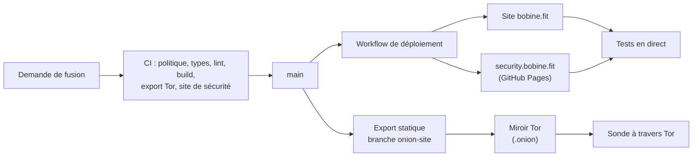

# bobine.fit

<p align="center">
  
</p>

Le site de **Bobine**, système de diffusion vidéo open source, auto-hébergé et hors ligne pour salles de sport, studios de cycling et clubs de fitness : vitrine, documentation, comparatifs, boutique matériel et assistant Baamix.

[](https://github.com/FantasmaGlad/BobineWeb/actions/workflows/deploy.yml)
[](https://github.com/FantasmaGlad/BobineWeb/actions/workflows/codeql.yml)


English: [README.md](README.md).

| | |
|---|---|
| Site | <https://bobine.fit> |
| Miroir Tor | `http://bobinedaoki42tt33rxacmtaab2gxvxb2orqgcyhvowv3aggxhruvrid.onion/` |
| Dépôt APT | <https://apt.bobine.fit> |
| Site de divulgation | <https://security.bobine.fit> |
| Logiciel | [FantasmaGlad/Bobine](https://github.com/FantasmaGlad/Bobine) (AGPL-3.0) |
| Ce dépôt | les sources du site, publiées pour être lues : voir [Licence](#licence) |

## Téléchargements du logiciel Bobine

Versions binaires officielles et modes d'installation du système de diffusion vidéo Bobine :

| Plateforme | Format | Architecture | Téléchargement direct / Commande | Profil & Fonctionnalités Clés |
| :--- | :---: | :---: | :---: | :--- |
|  | <sub>`.apk`<br>*(Paquet natif)*</sub> | <sub>ARM64<br>*(arm64-v8a)*</sub> | <sub>[**Télécharger Bobine-4.0.3.apk**](https://github.com/FantasmaGlad/Bobine/releases/download/V4.0.3/Bobine-4.0.3.apk)</sub> | **Tablettes Android**<br><sub>Pupitre coach tactile (`/grid`) + grand écran HDMI (`/cinema`)</sub> |
|  | <sub>`.apk`<br>*(Paquet TV dédié)*</sub> | <sub>ARM64<br>*(arm64-v8a)*</sub> | <sub>[**Télécharger Bobine-TV-4.0.3.apk**](https://github.com/FantasmaGlad/Bobine/releases/download/V4.0.3/Bobine-TV-4.0.3.apk)</sub> | **Android TV & Google TV**<br><sub>Bannière Leanback TV, navigation télécommande D-Pad, mode autonome</sub> |
|  | <sub>`.exe`<br>*(Installeur)*</sub> | <sub>x86-64</sub> | <sub>[**Télécharger Bobine-Setup-4.0.3.exe**](https://github.com/FantasmaGlad/Bobine/releases/download/V4.0.3/Bobine-Setup-4.0.3.exe)</sub> | **PC de bureau & Portables Windows**<br><sub>Installeur avec raccourci, zone de notification, mode clamshell</sub> |
|    | <sub>`.deb`<br>*(Paquet & Dépôt)*</sub> | <sub>x86-64<br>*(amd64)*</sub> | <sub>[**Dépôt APT apt.bobine.fit**](https://apt.bobine.fit)<br>[**bobine_4.0.3_amd64.deb**](https://github.com/FantasmaGlad/Bobine/releases/download/V4.0.3/bobine_4.0.3_amd64.deb)</sub> | **Postes Linux & PC Reconditionnés**<br><sub>Paquet officiel `.deb` et dépôt `apt.bobine.fit`</sub> |
|  | <sub>`.dmg`<br>*(Image disque)*</sub> | <sub>Apple Silicon<br>*(arm64)*</sub> | <sub>[**Télécharger Bobine-4.0.3.dmg**](https://github.com/FantasmaGlad/Bobine/releases/download/V4.0.3/Bobine-4.0.3.dmg)</sub> | **MacBook, Mac mini & iMac**<br><sub>Glisser-déposer `.dmg`, Apple Silicon & Intel, barre de menus</sub> |
|  | <sub>App iPadOS<br>*(Piste explorée)*</sub> | <sub>ARM64 (Apple Silicon)</sub> | <sub>*Piste explorée...*</sub> | **iPads & Tablettes Apple (Piste explorée)**<br><sub>Prototype pupitre coach avec sortie vidéo USB-C / Thunderbolt</sub> |
|  | <sub>Binaire natif<br>*(Tauri 2)*</sub> | <sub>x86-64 (Linux)</sub> | <sub>[**Télécharger bobine-assistant**](https://github.com/FantasmaGlad/Bobine/releases/download/V4.0.3/bobine-assistant)</sub> | **Assistant Graphique de Déploiement**<br><sub>Découverte réseau locale, audit matériel et déploiement SSH</sub> |
|  | <sub>Script Shell<br>*(Automatisé)*</sub> | <sub>x86-64</sub> | <sub>`curl -sSL https://bobine.fit/install.sh \| bash`</sub> | **Appliance Dédiée Headless**<br><sub>Installation automatisée en 18 étapes sur mini-PC (Debian 13)</sub> |
| [](http://bobinedaoki42tt33rxacmtaab2gxvxb2orqgcyhvowv3aggxhruvrid.onion/) | <sub>Dépôt APT & Miroir<br>*(Réseau Tor)*</sub> | <sub>x86-64<br>*(amd64)*</sub> | <sub>`curl -fsSL https://bobine.fit/install-tor.sh \| bash`<br>[**Site miroir .onion**](http://bobinedaoki42tt33rxacmtaab2gxvxb2orqgcyhvowv3aggxhruvrid.onion/)<br>[**Dépôt APT .onion**](http://rzvwjat5pidtxtwzcsvew7yc5ugfjvzz432ecpn3s5mlch4cs7vvmqad.onion/)</sub> | **Distribution Tor (.onion)**<br><sub>Dépôt APT et miroir anonymes sans exposition d'adresse IP</sub> |
| [](https://bobine.fit) | <sub>Portail Web</sub> | <sub>Universel</sub> | <sub>[**Visiter bobine.fit**](https://bobine.fit)</sub> | **Site Officiel & Documentation**<br><sub>Guides de prise en main, conseils matériel et base de connaissances</sub> |
|  | <sub>Binaires & Sources</sub> | <sub>Multi-OS</sub> | <sub>[**Voir les Releases GitHub**](https://github.com/FantasmaGlad/Bobine/releases/latest)</sub> | **Releases & Code Source**<br><sub>Sommes de contrôle SHA-256 certifiées, archives et historique</sub> |

## Points forts

- **Deux langues, une seule source.** Les pages françaises et anglaises partagent une source de contenu unique (`src/content/docs/`) qui alimente la documentation, la FAQ, le PDF téléchargeable et l'assistant : une information s'écrit une seule fois.
- **Design system à 17 thèmes** (8 clairs, 9 sombres), en variables CSS pures, calibré pour les contrastes WCAG AA et AAA, avec des animations d'interface qui respectent `prefers-reduced-motion`.
- **3D interactive** avec Three.js et React Three Fiber, avec des décodeurs servis localement pour ne contacter aucun tiers.
- **Un miroir Tor construit depuis le même code.** Le site est exporté en statique et servi comme service onion v3, à côté d'un dépôt APT. La construction retire toutes les routes serveur et fait échouer la chaîne si un lien marchand, une ressource externe ou un script de mesure s'y glisse.
- **Baamix**, un assistant qui répond sur l'installation et le choix du matériel. Ses fiches produit viennent du vrai catalogue, jamais du texte du modèle.
- **Une boutique matériel avec panier en direct**, des catalogues d'affiliation Amazon et AliExpress, et un seul endroit pour chaque prix et chaque identifiant.
- **Une posture de sécurité vérifiable.** Un `security.txt` signé OpenPGP ([RFC 9116](https://www.rfc-editor.org/rfc/rfc9116)), une clé de réception des rapports dont l'empreinte est contrôlée chaque jour sur quatre canaux indépendants, et un site de divulgation hébergé séparément du site.
- **Une chaîne de livraison conduite par GitHub Actions** : validation, déploiement et tests en direct forment un seul workflow, et l'intégration Git de l'hébergeur est désactivée.

## Architecture



| Domaine | Choix |
|---|---|
| Framework | Next.js 16 (App Router, Turbopack), React 19, TypeScript |
| Contenu | MDX et modules de données typés ; export PDF avec `@react-pdf/renderer` |
| Style | CSS pur à variables, aucun framework d'interface |
| 3D | Three.js, React Three Fiber, Drei |
| Assistant | Route serveur avec repli entre fournisseurs ; catalogue résolu côté serveur |
| Hébergement | Vercel derrière Cloudflare, déployé par GitHub Actions ; miroir Tor sur une machine auto-hébergée |

## Qualité et livraison

Rien n'est publié sans passer par le workflow de validation, qui contrôle à chaque demande de fusion :

- la politique du dépôt : seules des entrées de racine autorisées, aucun secret, aucun emoji, aucun trailer interdit ;
- `tsc --noEmit`, ESLint et le build de production ;
- l'export statique du miroir Tor et ses garanties (aucune ressource externe, aucun lien marchand, aucun script de mesure) ;
- le site de sécurité : signature de `security.txt`, empreinte, expirations, liens locaux.

Après publication, des tests en direct interrogent le vrai site, le site de divulgation et le service onion à travers Tor. CodeQL et un contrôle quotidien de l'empreinte OpenPGP tournent en continu. Détails : [`docs/DEVELOPPEMENT.md`](docs/DEVELOPPEMENT.md).

## Le lancer en local

Pour lire et relire seulement : la [licence](#licence) n'accorde pas le droit d'utiliser ni de déployer ce code.

```bash
npm ci
cp .env.example .env.local   # facultatif : le site fonctionne sans aucune clé
npm run dev                  # http://localhost:3000
```

## Sécurité

Signalez les vulnérabilités en privé, jamais par ticket public : voir [SECURITY.md](docs/fr/SECURITY.md) et <https://bobine.fit/fr/securite>. L'empreinte de la clé de réception est `23CA D324 C507 FB0F 97E6 AECA 6E4C 020E F8BD FEB2`.

## Contribuer

Les signalements d'erreurs et les suggestions sont bienvenus sous forme de tickets ; les contributions de code suivent [CONTRIBUTING.md](docs/fr/CONTRIBUTING.md) et le [code de conduite](docs/fr/CODE_OF_CONDUCT.md). Les contributions sont cédées à Bobine, comme expliqué dans ce guide.

## Licence

Copyright (c) 2026 Bobine. Tous droits réservés. Les sources sont publiées pour être lues uniquement : vous n'avez pas le droit de les copier, de les utiliser, de les modifier ni de les distribuer. Voir [LICENSE](LICENSE) et [NOTICE.md](NOTICE.md) pour les éléments tiers. Le logiciel Bobine est un projet distinct sous GNU AGPL-3.0.
