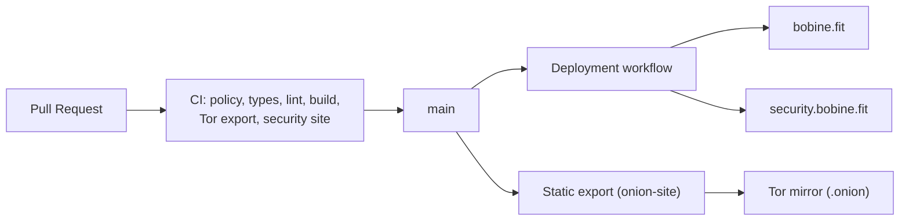

# bobine.fit

<p align="center">
  
</p>

The official website of **Bobine**, an open-source, self-hosted and offline-first video playout system for gyms, cycling studios and fitness clubs: showcase, documentation, comparisons, hardware guide and the Baamix assistant.

[](https://github.com/FantasmaGlad/BobineWeb/actions/workflows/deploy.yml)
[](https://github.com/FantasmaGlad/BobineWeb/actions/workflows/codeql.yml)


Français : [README.fr.md](README.fr.md).

| Property | URL / Repository |
| :--- | :--- |
| **Main Website** | <https://bobine.fit> |
| **Tor Mirror (.onion)** | `http://bobinedaoki42tt33rxacmtaab2gxvxb2orqgcyhvowv3aggxhruvrid.onion/` |
| **Linux Package Portal** | <https://packages.bobine.fit> *(APT, DNF, Pacman)* |
| **Security & Disclosure Portal** | <https://security.bobine.fit> |
| **Bobine Software Repository** | [FantasmaGlad/Bobine](https://github.com/FantasmaGlad/Bobine) (`V5.0.7`, AGPL-3.0) |
| **This Repository** | Website source published for reading — see [License](#license) |

---

## Bobine Ecosystem Constellation

The Bobine web ecosystem is organized across four specialized properties sharing the same 16-theme design system:

- **Main Website (`bobine.fit`)**: Showcase, documentation, independent hardware catalog, three-channel blog, and the Baamix assistant. Built with Next.js 16 (App Router, Turbopack), React 19, and TypeScript.
- **Package Portal (`packages.bobine.fit`)**: Official GPG-signed Linux repositories (Debian/Ubuntu APT, Fedora DNF/RPM, Arch Linux Pacman) across Stable, Beta, and Canary channels (`x86_64` and `arm64`, glibc 2.38+).
- **Security Portal (`security.bobine.fit`)**: Standalone static site, RFC 9116 compliant (`/.well-known/security.txt`), publishing the official OpenPGP key (`23CA D324 C507 FB0F 97E6 AECA 6E4C 020E F8BD FEB2`) and disclosure policy.
- **Tor Sovereign Mirror (`.onion`)**: Static export of `bobine.fit` served over the Tor network without external requests or affiliate links, alongside its onion APT mirror (`http://rzvwjat5pidtxtwzcsvew7yc5ugfjvzz432ecpn3s5mlch4cs7vvmqad.onion/`).



---

## Page Structure & Bilingual Routes

All pages are served in French (`/fr/`) and English (`/en/`) from a single typed source of truth (`src/content/`):

| Route (EN) | Route (FR) | Purpose |
| :--- | :--- | :--- |
| `/` | `/` | Homepage, fitness playout showcase, OS download grid, and 16-theme switcher |
| `/download` | `/telechargement` | Unified cross-platform `V5.0.7` download hub (Windows 11 & 10, macOS Apple Silicon, Linux packages, Android, Android TV, Bash CLI, Tor) |
| `/linux` | `/linux` | Certified Linux distribution families (Debian/Ubuntu, Fedora, Arch Linux) and repository setup |
| `/tor` | `/tor` | Sovereign `.onion` website mirror and anonymous APT repository guide |
| `/comparisons` | `/comparatif` | Value proposition and technical comparison against proprietary fitness and generic signage platforms |
| `/features` | `/fonctionnalites` | Structured overview of playout, kiosk, coach desk, and radio capabilities |
| `/resources` | `/ressources` | Book-style A–Z index of open-source components, fonts, protocols, and licenses |
| `/hardware/aliexpress` | `/materiel/aliexpress` | Independent hardware selection (mini PCs, tablets, TV boxes, HDMI adapters) |
| `/hardware/amazon` | `/materiel/amazon` | Curated Amazon hardware selection and studio kits |
| `/channels` | `/canaux` | Overview of the Stable (`V5.0.7`), Beta, and Canary update channels |
| `/blog` | `/blog` | Release notes for Stable, Beta, and Canary read from GitHub Releases |
| `/baamix` | `/baamix` | Interactive assistant grounded in the official documentation and hardware catalog |
| `/documentation` | `/documentation` | Complete user guide, studio operations manual, and FAQ (with PDF export) |
| `/privacy` · `/legal` | `/confidentialite` · `/mentions-legales` | Zero-telemetry privacy policy and legal notices |

Legacy routes (`/computer`, `/ordinateur`, `/google-book`, `/android-tv`, `/whats-new`, `/nouveautes`, `/security`, `/securite`) are permanently redirected via HTTP 308 in `next.config.ts`.

---

## Quality Gates & Delivery

Every pull request and deployment runs automated checks:

- **Repository policy** (`scripts/ci/policy-check.sh`): allow-listed root entries, zero secrets, zero emojis, zero forbidden trailers.
- **Type safety & build**: `npx tsc --noEmit`, ESLint, and Next.js production build.
- **Design system & contrast** (`scripts/ci/glass-check.mjs`, `scripts/ci/check-assets.mjs`): validates all 16 themes (8 light including the Apple-inspired *Charbon* theme, 8 high-contrast dark themes) and vector brand icons.
- **Installer & release sync** (`scripts/ci/sync-install.mjs`, `scripts/ci/check-simulator-sync.sh`): fetches `install.sh` from the latest Stable release of Bobine, verifies its SHA-256 digest, and checks step parity with the interactive simulators.
- **Tor & Security portals** (`scripts/ci/check-onion-export.sh`, `scripts/ci/check-security-site.sh`): verifies zero external requests on the onion export and OpenPGP signature validity on `security.txt`.

---

## Local Development

For reading and reviewing only (see [License](#license)):

```bash
npm ci
cp .env.example .env.local   # optional: the site runs without any key
node scripts/ci/sync-install.mjs
npm run dev                  # http://localhost:3000
```

---

## Security, Contributing & License

- **Security**: Report vulnerabilities privately — see [SECURITY.md](SECURITY.md) and <https://security.bobine.fit/>. OpenPGP key fingerprint: `23CA D324 C507 FB0F 97E6 AECA 6E4C 020E F8BD FEB2`.
- **Contributing**: Issue reports and contributions follow [CONTRIBUTING.md](CONTRIBUTING.md) and [CODE_OF_CONDUCT.md](CODE_OF_CONDUCT.md).
- **License**: Copyright (c) 2026 Bobine. All rights reserved. The website source is published for reading only: you may not copy, use, modify, or distribute it. See [LICENSE](LICENSE) and [NOTICE.md](NOTICE.md). The Bobine software itself is a separate project licensed under the [GNU AGPL-3.0](https://github.com/FantasmaGlad/Bobine/blob/main/LICENSE).
