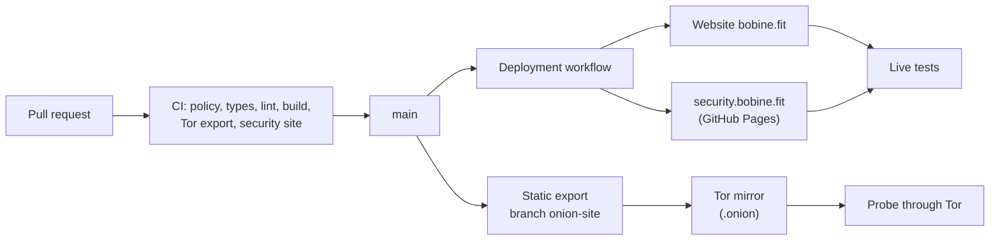

# bobine.fit

<p align="center">
  
</p>

The website of **Bobine**, an open-source, self-hosted and offline-first video playout system for gyms, cycling studios and fitness clubs: showcase, documentation, comparisons, hardware shop and the Baamix assistant.

[](https://github.com/FantasmaGlad/BobineWeb/actions/workflows/deploy.yml)
[](https://github.com/FantasmaGlad/BobineWeb/actions/workflows/codeql.yml)


Français : [README.fr.md](README.fr.md).

| | |
|---|---|
| Website | <https://bobine.fit> |
| Tor mirror | `http://bobinedaoki42tt33rxacmtaab2gxvxb2orqgcyhvowv3aggxhruvrid.onion/` |
| APT repository | <https://apt.bobine.fit> |
| Disclosure site | <https://security.bobine.fit> |
| Software | [FantasmaGlad/Bobine](https://github.com/FantasmaGlad/Bobine) (AGPL-3.0) |
| This repository | the source of the website, published to be read: see [License](#license) |

## Download Bobine Software

Official binary releases and installation methods for the Bobine video playout system:

| Platform | Format | Architecture | Direct Download / Command | Target Profile & Key Features |
| :--- | :---: | :---: | :---: | :--- |
|  | <sub>`.apk`<br>*(Native Package)*</sub> | <sub>ARM64<br>*(arm64-v8a)*</sub> | <sub>[**Download Bobine-5.0.2.apk**](https://github.com/FantasmaGlad/Bobine/releases/download/V5.0.2/Bobine-5.0.2.apk)</sub> | **Android Tablets, Google Books & ARM Kiosks**<br><sub>Touch coach desk (`/grid`) + HDMI TV cinema (`/cinema`), Google Books via APK (and soon native Google Play Store)</sub> |
|  | <sub>`.apk`<br>*(Dedicated TV Package)*</sub> | <sub>ARM 32 & 64-bit<br>*(armeabi-v7a, arm64-v8a)*</sub> | <sub>[**Download Bobine-TV-5.0.2.apk**](https://github.com/FantasmaGlad/Bobine/releases/download/V5.0.2/Bobine-TV-5.0.2.apk)</sub> | **Android TV & Google TV**<br><sub>Leanback TV launcher, D-Pad remote navigation, offline kiosk</sub> |
|  | <sub>`.exe`<br>*(Installer)*</sub> | <sub>x86-64 & ARM64<br>*(Snapdragon)*</sub> | <sub>[**Bobine-Setup-5.0.2.exe (x86-64)**](https://github.com/FantasmaGlad/Bobine/releases/download/V5.0.2/Bobine-Setup-5.0.2.exe)<br>[**Bobine-Setup-5.0.2-arm64.exe (ARM64)**](https://github.com/FantasmaGlad/Bobine/releases/download/V5.0.2/Bobine-Setup-5.0.2-arm64.exe)</sub> | **Windows x86-64 & Windows ARM (Snapdragon)**<br><sub>Native 1-click installer for x86-64 and ARM64 (Snapdragon X Elite / X Plus), clamshell mode</sub> |
| [](https://www.debian.org/) [](https://ubuntu.com/)<br>[](https://linuxmint.com/) [](https://system76.com/pop)<br>[](https://zorin.com/os/) | <sub>`.deb`<br>APT</sub> | <sub>x86-64 (`amd64`)<br>ARM64 (`arm64`)</sub> | <sub>[**APT repository**](https://apt.bobine.fit)<br>[**bobine_5.0.2_amd64.deb**](https://github.com/FantasmaGlad/Bobine/releases/download/V5.0.2/bobine_5.0.2_amd64.deb)<br>[**bobine_5.0.2_arm64.deb**](https://github.com/FantasmaGlad/Bobine/releases/download/V5.0.2/bobine_5.0.2_arm64.deb)</sub> | **Debian, Ubuntu and derivatives**<br><sub>Packages available. Linux Mint (Ubuntu or LMDE), Pop!_OS and Zorin OS: use the APT family package if dependencies are satisfied; individual validation is still required.</sub> |
| [](https://fedoraproject.org/) [](https://nobaraproject.org/) | <sub>`.rpm`<br>DNF</sub> | <sub>x86-64 (`x86_64`)<br>ARM64 (`aarch64`)<br>planned targets</sub> | <sub>**In preparation**<br>[**RPM repository status**](https://github.com/FantasmaGlad/bobine-rpm)</sub> | **Fedora / Nobara**<br><sub>Signed package and repository integration is in progress. Nobara is a Fedora derivative; neither Fedora nor Nobara has been validated on hardware yet.</sub> |
| [](https://archlinux.org/) [](https://endeavouros.com/)<br>[](https://cachyos.org/) [](https://manjaro.org/) | <sub>`.pkg.tar.zst`<br>pacman</sub> | <sub>x86-64 (`x86_64`)<br>ARM64 (`aarch64`)<br>planned targets</sub> | <sub>**In preparation**<br>[**Arch repository status**](https://github.com/FantasmaGlad/bobine-arch)</sub> | **Arch Linux / derivatives**<br><sub>Signed package and repository integration is in progress. EndeavourOS and CachyOS are derivative targets awaiting validation. Manjaro needs a separate compatibility check because its repositories follow their own cadence.</sub> |
|  | <sub>`.dmg`<br>*(Disk Image)*</sub> | <sub>Apple Silicon<br>*(arm64)*</sub> | <sub>[**Download Bobine-5.0.2.dmg**](https://github.com/FantasmaGlad/Bobine/releases/download/V5.0.2/Bobine-5.0.2.dmg)</sub> | **MacBook, Mac mini & iMac**<br><sub>Drag-and-drop `.dmg`, Apple Silicon, menu bar companion</sub> |
|  | <sub>iPadOS App<br>*(Explored Track)*</sub> | <sub>ARM64 (Apple Silicon)</sub> | <sub>*Explored track...*</sub> | **iPads & Apple Tablets (Explored Track)**<br><sub>Touch coach desk prototype with USB-C / Thunderbolt video output</sub> |
|  | <sub>Native Binary<br>*(Tauri 2)*</sub> | <sub>x86-64 & ARM64<br>*(Linux)*</sub> | <sub>[**bobine-assistant (x86-64)**](https://github.com/FantasmaGlad/Bobine/releases/download/V5.0.2/bobine-assistant)<br>[**bobine-assistant-arm64 (ARM64)**](https://github.com/FantasmaGlad/Bobine/releases/download/V5.0.2/bobine-assistant-arm64)</sub> | **Management Assistant (GUI)**<br><sub>Network auto-discovery, SSH remote deploy & update tool</sub> |
|  | <sub>Shell Script<br>*(Automated)*</sub> | <sub>x86-64 & ARM64</sub> | <sub>`curl -sSL https://bobine.fit/install.sh \| bash`</sub> | **Headless Dedicated Appliance**<br><sub>Automated install for bare-metal mini PCs and ARM64 stations (Debian 13)</sub> |
| [](http://bobinedaoki42tt33rxacmtaab2gxvxb2orqgcyhvowv3aggxhruvrid.onion/) | <sub>APT Repo & Mirror<br>*(Tor Network)*</sub> | <sub>x86-64 & ARM64</sub> | <sub>`curl -fsSL https://bobine.fit/install-tor.sh \| bash`<br>[**Tor Mirror (.onion)**](http://bobinedaoki42tt33rxacmtaab2gxvxb2orqgcyhvowv3aggxhruvrid.onion/)<br>[**APT Repo (.onion)**](http://rzvwjat5pidtxtwzcsvew7yc5ugfjvzz432ecpn3s5mlch4cs7vvmqad.onion/)</sub> | **Tor Network (.onion)**<br><sub>Anonymous APT repo (Stable, Beta and Canary suites, channel chosen with `--channel`) and website mirror without IP exposure</sub> |
| [](https://bobine.fit) | <sub>Web Portal</sub> | <sub>Universal</sub> | <sub>[**Visit bobine.fit**](https://bobine.fit)</sub> | **Official Website**<br><sub>Getting started guides, hardware recommendations & docs</sub> |
|  | <sub>Source & Binaries</sub> | <sub>Multi-OS</sub> | <sub>[**Browse GitHub Releases**](https://github.com/FantasmaGlad/Bobine/releases/latest)</sub> | **Releases & Source Code**<br><sub>Certified SHA-256 checksums, tarballs & full changelog</sub> |

### Linux distributions: support scope

Logos link to the distributions’ official websites. APT links lead to available packages; RPM and Arch links show repository rollout status. Distributions in the same family share a package format, which does not guarantee every version, dependency set, architecture or hardware configuration. Listing a derivative above does not mean it has been individually validated for Bobine.

[](https://www.redhat.com/en/technologies/linux-platforms/enterprise-linux) [](https://almalinux.org/) [](https://rockylinux.org/)

RHEL, AlmaLinux and Rocky Linux are RPM-family systems requiring separate evaluation: compatibility with the Fedora package is unproven, and adding EPEL alone does not establish it. Immutable editions (Silverblue, Kinoite, Bazzite) need a dedicated installation method that is not provided here. The kiosk appliance installer still targets **Debian 13**; desktop package support does not extend that installer to other distributions. ARM64 binaries require an ARM64 system and do not imply that every derivative offers that architecture.

## Highlights

- **Two languages, one source of truth.** French and English pages share a single content source (`src/content/docs/`) that feeds the documentation, the FAQ, the downloadable PDF and the assistant, so a fact is written once.
- **Design system with 16 themes** (8 light, 8 dark), unified with the Bobine application in plain CSS variables, calibrated for WCAG AA and AAA contrast, with interface animations that respect `prefers-reduced-motion`.
- **Translucent glass built from tokens.** Every blur and glass surface comes from variables (`--blur-*`, `--glass-*`, including `--glass-modal-bg` for the download window), with a `prefers-reduced-transparency` mode; `scripts/ci/glass-check.mjs` fails the pipeline on a frozen value, an undefined variable or a text contrast below target on any of the 16 themes.
- **Three update channels everywhere.** Stable, Beta and Canary are offered in the download window, on every search-indexed page (device-aware download card), in the shell installers (`install.sh --channel=stable|beta|canary`, and `install-tor.sh --channel=stable|beta|canary` with an interactive prompt on a terminal) and in the two installation simulators (shell, with a Tor mode that asks for the channel, and the Tauri assistant with its three channel cards).
- **A Tor mirror built from the same code.** The site is exported as a static build and served as a v3 onion service, next to an APT repository that publishes the three suites (`stable`, `beta`, `canary`). The build removes every server route and fails the pipeline if a marketplace link, an external resource or an analytics script slips in.
- **Baamix**, an assistant that answers about installation and hardware choice. Its product cards come from the real catalog, never from the model's text.
- **A hardware shop with live shopping basket**, Amazon and AliExpress affiliate catalogs, and one place for every price and identifier.
- **Verifiable security posture.** An OpenPGP-signed `security.txt` ([RFC 9116](https://www.rfc-editor.org/rfc/rfc9116)), a published report key whose fingerprint is checked daily across four independent channels, and a disclosure site hosted separately from the website.
- **A delivery pipeline run by GitHub Actions**: validation, deployment and live tests are one workflow, and the host's own Git integration is switched off.

## Architecture



| Area | Choice |
|---|---|
| Framework | Next.js 16 (App Router, Turbopack), React 19, TypeScript |
| Content | Typed data modules (`src/content/`), release notes read from GitHub Releases; PDF export with `@react-pdf/renderer` |
| Styling | Plain CSS with variables, no UI framework |
| Assistant | Server route with provider fallback; catalog resolved server-side |
| Hosting | Vercel behind Cloudflare, deployed by GitHub Actions; Tor mirror on a self-hosted machine |

## Quality and delivery

Nothing is published without passing the validation workflow, which checks on every pull request:

- repository policy: only an allow-listed set of root entries, no secret, no emoji, no forbidden trailer;
- `tsc --noEmit`, ESLint and the production build;
- the glass and style tokens, and text contrast on every glass material of the 16 themes (`glass-check.mjs`);
- the installation simulators against the published scripts (`check-simulator-sync.sh`: same step titles, same three channels);
- the static Tor export and its guarantees (no external resource, no marketplace link, no measurement script), ShellCheck on the shell scripts, and the identity of `public/install-tor.sh` with its deployment copy;
- the security site: signature of `security.txt`, fingerprint, expirations, local links (`check-security-site.sh`).

After publication, live tests query the real website, the disclosure site and the onion service through Tor. CodeQL, a daily check of the OpenPGP fingerprint and a daily consistency check with the Bobine releases (`check-release-sync.sh`: `install.sh` identical to the software's, download files present for Stable, Beta and Canary) run continuously.

## Run it locally

For reading and reviewing only: the [license](#license) does not grant the right to use or deploy this code.

```bash
npm ci
cp .env.example .env.local   # optional: the site works without any key
npm run dev                  # http://localhost:3000
```

## Security

Report vulnerabilities privately, never through a public issue: see [SECURITY.md](SECURITY.md) and <https://bobine.fit/en/security>. The report key fingerprint is `23CA D324 C507 FB0F 97E6 AECA 6E4C 020E F8BD FEB2`.

## Contributing

Mistake reports and suggestions are welcome as issues; code contributions follow [CONTRIBUTING.md](CONTRIBUTING.md) and the [Code of Conduct](CODE_OF_CONDUCT.md). Contributions are assigned to Bobine, as explained there.

## License

Copyright (c) 2026 Bobine. All rights reserved. The source is published for reading only: you may not copy, use, modify or distribute it. See [LICENSE](LICENSE) and [NOTICE.md](NOTICE.md) for third-party components. The Bobine software is a separate project under the GNU AGPL-3.0.
