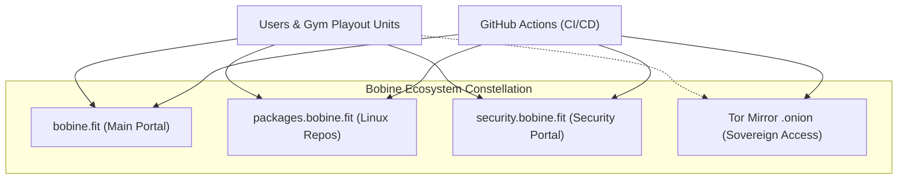
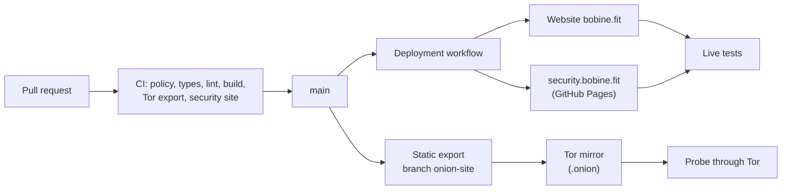

# bobine.fit

<p align="center">
  
</p>

<table align="center">
  <tr>
    <td align="center" valign="middle"><a href="https://frame.work/"></a></td>
    <td align="center" valign="middle"><a href="https://www.mozilla.org/en-US/firefox/"></a></td>
  </tr>
</table>

<p align="center">
  <b>Certified cross-OS compatibility & modular <a href="https://frame.work/">Framework Laptops</a>.</b><br>
  <sub>Repairable modular <a href="https://frame.work/">Framework Laptop</a> ecosystem (AMD Ryzen, Intel Core Ultra, Qualcomm Snapdragon X ARM), official Linux repositories on <a href="https://packages.bobine.fit">packages.bobine.fit</a>, and Firefox 157 verification. <a href="https://frame.work/">Explore Framework</a> &nbsp;·&nbsp; <a href="https://packages.bobine.fit">Linux Repos</a></sub>
</p>

<p align="center">
  <sub>#video #streaming #fitness #gym #digital-signage #media-player #self-hosted #open-source #automation #kiosk #offline-first #nextjs #rust #tauri #linux #cross-platform #display #appliance #framework</sub>
</p>

The website of **Bobine**, an open-source, self-hosted and offline-first video playout system for gyms, cycling studios and fitness clubs: showcase, documentation, comparisons, hardware shop and the Baamix assistant.

[](https://github.com/FantasmaGlad/BobineWeb/actions/workflows/deploy.yml)
[](https://github.com/FantasmaGlad/BobineWeb/actions/workflows/codeql.yml)


Français : [README.fr.md](README.fr.md).

| | |
|---|---|
| Website | <https://bobine.fit> |
| Tor mirror | `http://bobinedaoki42tt33rxacmtaab2gxvxb2orqgcyhvowv3aggxhruvrid.onion/` |
| Linux Repositories (APT, DNF, Pacman) | <https://packages.bobine.fit> |
| Disclosure site | <https://security.bobine.fit> |
| Software | [FantasmaGlad/Bobine](https://github.com/FantasmaGlad/Bobine) (AGPL-3.0) |
| This repository | the source of the website, published to be read: see [License](#license) |

## Download Bobine Software

Official binary releases and installation methods for the Bobine video playout system:

| Platform | Format | Architecture | Direct Download / Command | Target Profile & Key Features |
| :--- | :---: | :---: | :---: | :--- |
|  | <sub>`.apk`<br>*(Native Package)*</sub> | <sub>ARM64<br>*(arm64-v8a)*</sub> | <sub>[**Download Bobine-5.0.5.apk**](https://github.com/FantasmaGlad/Bobine/releases/download/V5.0.5/Bobine-5.0.5.apk)</sub> | **Android Tablets, Google Books & ARM Kiosks**<br><sub>Touch coach desk (`/grid`) + HDMI TV cinema (`/cinema`), Google Books via APK (and soon native Google Play Store)</sub> |
|  | <sub>`.apk`<br>*(Dedicated TV Package)*</sub> | <sub>ARM 32 & 64-bit<br>*(armeabi-v7a, arm64-v8a)*</sub> | <sub>[**Download Bobine-TV-5.0.5.apk**](https://github.com/FantasmaGlad/Bobine/releases/download/V5.0.5/Bobine-TV-5.0.5.apk)</sub> | **Android TV & Google TV**<br><sub>Leanback TV launcher, D-Pad remote navigation, offline kiosk</sub> |
|  | <sub>`.exe`<br>*(Installer)*</sub> | <sub>x86-64 & ARM64<br>*(Snapdragon)*</sub> | <sub>[**Bobine-Setup-5.0.5.exe (x86-64)**](https://github.com/FantasmaGlad/Bobine/releases/download/V5.0.5/Bobine-Setup-5.0.5.exe)<br>[**Bobine-Setup-5.0.5-arm64.exe (ARM64)**](https://github.com/FantasmaGlad/Bobine/releases/download/V5.0.5/Bobine-Setup-5.0.5-arm64.exe)</sub> | **Windows x86-64 & Windows ARM (Snapdragon)**<br><sub>Native 1-click installer for x86-64 and ARM64 (Snapdragon X Elite / X Plus), clamshell mode</sub> |
| [](https://www.debian.org/) [](https://ubuntu.com/)<br>[](https://linuxmint.com/) [](https://system76.com/pop)<br>[](https://zorin.com/os/) | <sub>`.deb`<br>APT</sub> | <sub>x86-64 (`amd64`)<br>ARM64 (`arm64`)</sub> | <sub>[**APT Repository**](https://packages.bobine.fit/debian/)<br>[**bobine_5.0.5_amd64.deb**](https://github.com/FantasmaGlad/Bobine/releases/download/V5.0.5/bobine_5.0.5_amd64.deb)<br>[**bobine_5.0.5_arm64.deb**](https://github.com/FantasmaGlad/Bobine/releases/download/V5.0.5/bobine_5.0.5_arm64.deb)</sub> | **Debian, Ubuntu and derivatives**<br><sub>Packages available via [packages.bobine.fit/debian/](https://packages.bobine.fit/debian/). Native amd64 and arm64 support with automatic updates through apt.</sub> |
| [](https://fedoraproject.org/) [](https://nobaraproject.org/) | <sub>`.rpm`<br>DNF</sub> | <sub>x86-64 (`x86_64`)<br>ARM64 (`aarch64`)</sub> | <sub>[**DNF Repository**](https://packages.bobine.fit/fedora/)<br>[**bobine-5.0.5-1.x86_64.rpm**](https://github.com/FantasmaGlad/Bobine/releases/download/V5.0.5/bobine-5.0.5-1.x86_64.rpm)<br>[**bobine-5.0.5-1.aarch64.rpm**](https://github.com/FantasmaGlad/Bobine/releases/download/V5.0.5/bobine-5.0.5-1.aarch64.rpm)</sub> | **Fedora, Nobara and RPM derivatives**<br><sub>Packages available via [packages.bobine.fit/fedora/](https://packages.bobine.fit/fedora/). Signed DNF repository with official GPG key, 1-command install \`sudo dnf install bobine\`.</sub> |
| [](https://archlinux.org/) [](https://endeavouros.com/)<br>[](https://cachyos.org/) [](https://manjaro.org/) | <sub>`.pkg.tar.zst`<br>pacman</sub> | <sub>x86-64 (`x86_64`)<br>ARM64 (`aarch64`)</sub> | <sub>[**Pacman Repository**](https://packages.bobine.fit/arch/)<br>[**bobine-5.0.5-1-x86_64.pkg.tar.zst**](https://github.com/FantasmaGlad/Bobine/releases/download/V5.0.5/bobine-5.0.5-1-x86_64.pkg.tar.zst)<br>[**bobine-5.0.5-1-aarch64.pkg.tar.zst**](https://github.com/FantasmaGlad/Bobine/releases/download/V5.0.5/bobine-5.0.5-1-aarch64.pkg.tar.zst)</sub> | **Arch Linux, EndeavourOS, CachyOS and derivatives**<br><sub>Packages available via [packages.bobine.fit/arch/](https://packages.bobine.fit/arch/). Signed repository database, continuous rolling updates via \`pacman -Syu bobine\`.</sub> |
|  | <sub>`.dmg`<br>*(Disk Image)*</sub> | <sub>Apple Silicon<br>*(arm64)*</sub> | <sub>[**Download Bobine-5.0.5.dmg**](https://github.com/FantasmaGlad/Bobine/releases/download/V5.0.5/Bobine-5.0.5.dmg)</sub> | **MacBook, Mac mini & iMac**<br><sub>Drag-and-drop `.dmg`, Apple Silicon, menu bar companion</sub> |
|  | <sub>iPadOS App<br>*(Explored Track)*</sub> | <sub>ARM64 (Apple Silicon)</sub> | <sub>*Explored track...*</sub> | **iPads & Apple Tablets (Explored Track)**<br><sub>Touch coach desk prototype with USB-C / Thunderbolt video output</sub> |
|  | <sub>Native Binary<br>*(Tauri 2)*</sub> | <sub>x86-64 & ARM64<br>*(Linux)*</sub> | <sub>[**bobine-assistant (x86-64)**](https://github.com/FantasmaGlad/Bobine/releases/download/V5.0.5/bobine-assistant)<br>[**bobine-assistant-arm64 (ARM64)**](https://github.com/FantasmaGlad/Bobine/releases/download/V5.0.5/bobine-assistant-arm64)</sub> | **Management Assistant (GUI)**<br><sub>Network auto-discovery, SSH remote deploy & update tool</sub> |
|  | <sub>Shell Script<br>*(Automated)*</sub> | <sub>x86-64 & ARM64</sub> | <sub>`curl -sSL https://bobine.fit/install.sh \| bash`</sub> | **Headless Dedicated Appliance**<br><sub>Automated install for bare-metal mini PCs and ARM64 stations (Debian 13)</sub> |
| [](http://bobinedaoki42tt33rxacmtaab2gxvxb2orqgcyhvowv3aggxhruvrid.onion/) | <sub>APT Repo & Mirror<br>*(Tor Network)*</sub> | <sub>x86-64 & ARM64</sub> | <sub>`curl -fsSL https://bobine.fit/install-tor.sh \| bash`<br>[**Tor Mirror (.onion)**](http://bobinedaoki42tt33rxacmtaab2gxvxb2orqgcyhvowv3aggxhruvrid.onion/)<br>[**APT Repo (.onion)**](http://rzvwjat5pidtxtwzcsvew7yc5ugfjvzz432ecpn3s5mlch4cs7vvmqad.onion/)</sub> | **Tor Network (.onion)**<br><sub>Anonymous APT repo (Stable, Beta and Canary suites, channel chosen with `--channel`) and website mirror without IP exposure</sub> |
| [](https://bobine.fit) | <sub>Web Portal</sub> | <sub>Universal</sub> | <sub>[**Visit bobine.fit**](https://bobine.fit)</sub> | **Official Website**<br><sub>Getting started guides, hardware recommendations & docs</sub> |
|  | <sub>Source & Binaries</sub> | <sub>Multi-OS</sub> | <sub>[**Browse GitHub Releases**](https://github.com/FantasmaGlad/Bobine/releases/latest)</sub> | **Releases & Source Code**<br><sub>Certified SHA-256 checksums, tarballs & full changelog</sub> |

### Linux Distributions: Certified Support Scope & Ecosystem

Bobine provides seamless compatibility across the distributions and hardware architectures below. Click any logo or name to visit the official project website:

#### 1. Debian Family & Derivatives (Packages `.deb` & APT Repo on [packages.bobine.fit/debian/](https://packages.bobine.fit/debian/))
| Distribution | Role & Certification Status | Official Website |
| :--- | :--- | :---: |
|  **Debian** | Reference operating system for Bobine standalone appliances (Debian 13 Trixie & 12 Bookworm) | [debian.org](https://www.debian.org/) |
|  **Ubuntu** | Full Desktop & Server support (24.04 LTS, 22.04 LTS on x86_64 and ARM64) | [ubuntu.com](https://ubuntu.com/) |
|  **Linux Mint** | Native support for Cinnamon / MATE / Xfce desktops and LMDE | [linuxmint.com](https://linuxmint.com/) |
|  **Pop!_OS** | Supported on COSMIC / GNOME desktops with switchable graphics | [system76.com/pop](https://system76.com/pop/) |
|  **Zorin OS** | Intuitive studio workstation interface for reception and coaching desks | [zorin.com/os](https://zorin.com/os/) |
|  **Raspberry Pi OS** | Official support on Raspberry Pi 5 ARM64 (8 GB / 16 GB) | [raspberrypi.com](https://www.raspberrypi.com/software/) |

#### 2. Fedora Family & RPM Derivatives (Packages `.rpm` & DNF Repo on [packages.bobine.fit/fedora/](https://packages.bobine.fit/fedora/))
| Distribution | Role & Certification Status | Official Website |
| :--- | :--- | :---: |
|  **Fedora** | Main target for the RPM family (Workstation & Server x86_64 / aarch64) | [fedoraproject.org](https://fedoraproject.org/) |
|  **Nobara Linux** | Optimized Fedora base with preconfigured media codecs and VA-API acceleration | [nobaraproject.org](https://nobaraproject.org/) |
|  **RHEL** | Enterprise servers and workstations (via EPEL and RPM Fusion) | [redhat.com](https://www.redhat.com/) |
|  **AlmaLinux** | 100% binary compatible RHEL derivative | [almalinux.org](https://almalinux.org/) |
|  **Rocky Linux** | Sustainable community enterprise OS for production media servers | [rockylinux.org](https://rockylinux.org/) |
|  **openSUSE** | Supported on Leap & Tumbleweed (Zypper / RPM package management) | [opensuse.org](https://www.opensuse.org/) |

#### 3. Arch Linux Family & Derivatives (Packages `.pkg.tar.zst` & Pacman Repo on [packages.bobine.fit/arch/](https://packages.bobine.fit/arch/))
| Distribution | Role & Certification Status | Official Website |
| :--- | :--- | :---: |
|  **Arch Linux** | Cutting-edge rolling release distribution (x86_64 & Arch Linux ARM aarch64) | [archlinux.org](https://archlinux.org/) |
|  **EndeavourOS** | Arch-based workstation desktop system with Calamares installer | [endeavouros.com](https://endeavouros.com/) |
|  **CachyOS** | Performance-tuned x86-64-v3/v4 kernel with ultra-responsive BORE scheduler | [cachyos.org](https://cachyos.org/) |
|  **Manjaro Linux** | User-friendly desktop distribution with stabilized package curation | [manjaro.org](https://manjaro.org/) |

#### 4. Supported Operating Systems & Recommended Compatible Devices

> [!NOTE]
> **Independent Hardware Recommendations & Equipment Shop**: Bobine has **no commercial partnerships, sponsorships, or brand affiliations** with device manufacturers: these are strictly independent recommendations tested and proven for reliable 24/7 fitness studio and gym operations.
>
> **Recommendation Shop**: Explore our complete curated selection of tested playout units, cabling, and studio kits at [**bobine.fit/en/hardware/aliexpress**](https://bobine.fit/en/hardware/aliexpress).

| System / Recommended Ecosystem | Description & Support Details | Official Website |
| :--- | :--- | :---: |
|  **Framework Laptop** | Modular, upgradeable laptops (AMD Ryzen, Intel Core Ultra, Qualcomm Snapdragon ARM64) recommended for durability | [frame.work](https://frame.work/) |
|  **Windows 11 / 10** | Native standalone installer for x86-64 and Qualcomm Snapdragon X ARM64 laptops | [microsoft.com/windows](https://www.microsoft.com/windows) |
|  **macOS** | Universal disk image `.dmg` for Apple Silicon (M1–M4) and Intel Macs | [apple.com/macos](https://www.apple.com/macos/) |
|  **Android & Android TV** | Touch application for coach tablets, Google Books and Android TV / Google TV boxes | [android.com](https://www.android.com/) |
|  **Tor Network (.onion)** | Sovereign, anonymous APT repository and static mirror without IP exposure | [torproject.org](https://www.torproject.org/) |
|  **Linux Appliance (Debian 13)** | Dedicated locked-in kiosk appliance for 24/7 gym playout PCs (Dell Wyse 5070, DGX Spark) | [kernel.org](https://kernel.org/) |

##### Popular Recommended Device Categories & Brands

Beyond operating system environments, here are the popular device categories and brands extensively tested and recommended for Bobine:

- **Mini PCs & 24/7 Playout Appliances** *(Discreet, fanless or whisper-quiet, low energy consumption)*:
  - **Dell**: Wyse 5070 (reference fanless ultra-economical Debian 13 appliance), OptiPlex Micro (3000, 5000, 7000 series).
  - **HP**: ProDesk Mini, EliteDesk Mini.
  - **Lenovo**: ThinkCentre Tiny (M70q, M90q, ThinkCentre neo).
  - **NiPoGi & MeLE**: NiPoGi E1 (Intel N150), E3B (AMD Ryzen 5), H1 (Ryzen 7), MeLE Overclock 4C (ultra-thin fanless).
  - **Minisforum & GEEKOM**: Minisforum UM series (Ryzen), GEEKOM IT13 Max (Intel Core Ultra).
  - **ASUS & Intel**: ASUS NUC, Intel NUC (compact 10x10 cm square form factor).
  - **ARM64 SBCs**: Raspberry Pi 5 (8 GB / 16 GB), Orange Pi 5 Max, NVIDIA DGX Spark (Grace Blackwell GB10), Jetson Orin.
- **Laptops & Mobile Workstations** *(Touch console `/grid` dual-screen or rack clamshell playout)*:
  - **Framework Laptop**: Framework Laptop 13 & 16 (10/10 repairability index, modular hot-swappable HDMI cards, AMD Ryzen, Intel Core Ultra, Snapdragon X Elite ARM64).
  - **Apple**: MacBook Air & MacBook Pro (Apple Silicon M1, M2, M3, M4), Mac mini M4 / M4 Pro.
  - **Lenovo**: ThinkPad (T, X, E, L series), IdeaPad Slim, Yoga.
  - **Dell**: XPS 13 / 15 / 16, Latitude, Inspiron.
  - **HP & ASUS**: HP EliteBook, ProBook, OmniBook; ASUS Zenbook OLED, Vivobook S 15.
- **TV Boxes & Playout Media Players** *(Affordable large-screen streaming via Android TV / Google TV)*:
  - **Google**: Google TV Streamer 4K, Chromecast with Google TV (HD & 4K).
  - **Xiaomi**: Xiaomi TV Box S (2nd Gen) 4K, Xiaomi TV Stick 4K.
  - **Nokia & Strong**: Nokia Streaming Box 8000 / 8010, Strong LEAP-S3.
  - **NVIDIA**: Nvidia Shield TV & Shield TV Pro.
- **Tablets & Touch Kiosks** *(Coach touch console `/grid`, interactive member kiosk `/kiosk`, and remote voting)*:
  - **Samsung**: Galaxy Tab S9 / S10 Lite / S11 Ultra, Galaxy Tab A9+.
  - **Xiaomi**: Xiaomi Pad 6 / 7 / 8 (studio reference tablet with USB-C DisplayPort output).
  - **Lenovo**: Lenovo Idea Tab 11", Tab P11 / P12 Pro.
  - **Google Books**: Chromebooks with Google Play Store and touch screen (HP Chromebook x360, Acer Spin, Lenovo Duet, ASUS Chromebook Flip).
  - **Apple**: iPad (10th gen, iPad Air, iPad Pro) via fullscreen Safari / PWA.

> *Technical note: Find configuration guides, verified HDMI/USB-C cables, and wall-mount brackets in our [hardware recommendation shop](https://bobine.fit/en/hardware/aliexpress).*

#### 5. Supported Web Browsers
| Browser | Engine | Support Status & Validation | Official Website |
| :--- | :---: | :--- | :---: |
|  **Mozilla Firefox** | Gecko | **Certified reference browser** — verified end-to-end on Firefox 157 / Linux (17 automated CI checks). | [mozilla.org/firefox](https://www.mozilla.org/en-US/firefox/) |
|  **Google Chrome** | Blink | **Supported & Validated** — reference browser for the fullscreen kiosk on headless Debian 13 appliances. | [google.com/chrome](https://www.google.com/chrome/) |
|  **Microsoft Edge** | Blink | **Supported** — smooth operation under Windows 11/10 (x86-64 and ARM64 Snapdragon) and macOS. | [microsoft.com/edge](https://www.microsoft.com/edge) |
|  **Apple Safari** | WebKit | **Supported** — optimized touch console for iPad, iPhone and Mac desktop browsers. | [apple.com/safari](https://www.apple.com/safari/) |
|  **Tor Browser** | Gecko | **Supported** — certified for private and anonymous access to the `.onion` administration mirror. | [torproject.org/download](https://www.torproject.org/download/) |
|  **Brave Browser** | Blink | **Supported** — compatible with built-in privacy shields and hardware acceleration. | [brave.com](https://brave.com/) |


## Highlights

- **Two languages, one source of truth.** French and English pages share a single content source (`src/content/docs/`) that feeds the documentation, the FAQ, the downloadable PDF and the assistant, so a fact is written once.
- **Design system with 16 themes** (8 light, 8 dark), unified with the Bobine application in plain CSS variables, calibrated for WCAG AA and AAA contrast, with interface animations that respect `prefers-reduced-motion`.
- **Translucent glass built from tokens.** Every blur and glass surface comes from variables (`--blur-*`, `--glass-*`, including `--glass-modal-bg` for the download window), with a `prefers-reduced-transparency` mode; `scripts/ci/glass-check.mjs` fails the pipeline on a frozen value, an undefined variable or a text contrast below target on any of the 16 themes.
- **Three update channels everywhere.** Stable, Beta and Canary are offered in the download window, on every search-indexed page (device-aware download card), in the shell installers (`install.sh --channel=stable|beta|canary`, and `install-tor.sh --channel=stable|beta|canary` with an interactive prompt on a terminal) and in the two installation simulators (shell, with a Tor mode that asks for the channel, and the Tauri assistant with its three channel cards).
- **One native package per Linux family.** `.deb` (Debian, Ubuntu, Mint), `.rpm` (Fedora and derivatives) and pacman package (Arch Linux and derivatives), on x86-64 and ARM64, with one signed repository per family. Every file name, repository address, command and the key fingerprint live in `src/lib/linuxPackages.ts`, whose `PACKAGE_REPOS_LIVE` switch shows "Soon" for Fedora and Arch until their repositories are online.
- **A Tor mirror built from the same code.** The site is exported as a static build and served as a v3 onion service, next to an APT repository that publishes the three suites (`stable`, `beta`, `canary`). The build removes every server route and fails the pipeline if a marketplace link, an external resource or an analytics script slips in.
- **Baamix**, an assistant that answers about installation and hardware choice. Its product cards come from the real catalog, never from the model's text.
- **A hardware shop with live shopping basket**, Amazon and AliExpress affiliate catalogs, and one place for every price and identifier.
- **Verifiable security posture.** An OpenPGP-signed `security.txt` ([RFC 9116](https://www.rfc-editor.org/rfc/rfc9116)), a published report key whose fingerprint is checked daily across four independent channels, and a disclosure site hosted separately from the website.
- **A delivery pipeline run by GitHub Actions**: validation, deployment and live tests are one workflow, and the host's own Git integration is switched off.

## Page Structure & Navigation

The routes on Bobine Web are organized modularly with bilingual routing (`/fr/` and `/en/`):

| Route (EN) | Route (FR) | Description & Role |
|---|---|---|
| `/` | `/` | Homepage, fitness video playout showcase, Liquid Glass 16-theme switcher, and quick navigation. |
| `/download` | `/telechargement` | Unified cross-platform V5.0.5 download hub (Windows x86-64 & ARM64 Snapdragon, macOS Apple Silicon, Android APK, Android TV APK, Linux packages, Bash CLI, Tor mirror) with channel switcher. |
| `/resources` | `/ressources` | Interactive A-Z index of project resources, third-party libraries, fonts, components and licenses, featuring instant client-side search without page reload. |
| `/features` | `/fonctionnalites` | Streamlined Google Documentation format (`.features-doc-list`) highlighting technical capabilities without visual clutter. |
| `/comparisons` | `/comparatif` | Technical comparison matrix against existing fitness solutions (Wexer, Les Mills, Radical Fitness / Yako, standard signage) with crisp official vector brand logos (`BrandIcon`). |
| `/hardware/aliexpress` | `/materiel/aliexpress` | Curated and field-tested AliExpress hardware selection (24/7 kiosk mini PCs, fanless units, coach tablets, cabling and adapters). |
| `/hardware/amazon` | `/materiel/amazon` | Curated Amazon hardware selection, product specifications and studio kits. |
| `/linux` | `/linux` | Dedicated Linux ecosystem hub, certified distributions (Debian, Ubuntu, Fedora, Arch Linux, Raspberry Pi OS), and copy-paste installation commands. |
| `/channels` | `/canaux` | Detailed overview of the three release channels (Stable V5.0.5, Beta, Canary) and delivery cycles. |
| `/blog` | `/blog` | Technical release notes and announcements for the three active channels (Stable V5.0.5, Beta, Canary), redirecting older history to GitHub Releases archives. |
| `/baamix` | `/baamix` | Baamix interactive assistant for gym hardware sizing, setup and deployment recommendations. |
| `/documentation` | `/documentation` | Comprehensive technical knowledge base (installation guides, studio operations, developer guide, and FAQ). |
| `/privacy` | `/confidentialite` | Privacy policy and strict tracker-free guarantees (zero telemetry, zero marketing cookies). |
| `/legal` | `/mentions-legales` | Legal notices and publisher information. |

### Permanent SEO Redirects (HTTP 308)

As part of the architecture cleanup, obsolete routes have been permanently removed and redirected via HTTP 308 in `next.config.ts`:
- `/computer` (`/ordinateur`) → `/download` (`/telechargement`)
- `/google-book` → `/download` (`/telechargement`)
- `/android-tv` → `/download` (`/telechargement`)
- `/whats-new` (`/nouveautes`) → `/blog`
- `/security` (`/securite`) → `https://security.bobine.fit`

## Architecture

### Bobine Ecosystem Constellation

The Bobine ecosystem is distributed across a constellation of specialized, independent web properties sharing the Liquid Glass design system:

- **Main Website (`bobine.fit`)**: Showcase, documentation, hardware catalog, three-tier blog, and the Baamix assistant. Built with Next.js 16 (App Router, Turbopack), React 19, and TypeScript.
- **Package Portal (`packages.bobine.fit`)**: Official Linux repositories (Debian/Ubuntu APT, Fedora DNF/RPM, Arch Linux Pacman), official GPG key `bobine.gpg`, official channel badges (Stable, Beta, Canary), processor and browser logos, with Lavender as default theme.
- **Security & Disclosure Portal (`security.bobine.fit`)**: Standalone static SSG site, RFC 9116 compliant (`/.well-known/security.txt`), official OpenPGP key (`security.asc` - fingerprint `23CA D324 C507 FB0F 97E6 AECA 6E4C 020E F8BD FEB2`), responsible disclosure policy, theme controls, and the classic Snake arcade game.
- **Tor Sovereign Mirror (`.onion`)**: Clean static build of `bobine.fit` served over the Tor network without external requests or affiliate links, alongside its onion APT mirror repository.



### Technical Pipeline and Technology Choices



| Area | Choice |
|---|---|
| Framework | Next.js 16 (App Router, Turbopack), React 19, TypeScript |
| Content | Typed data modules (`src/content/`), release notes read from GitHub Releases; PDF export with `@react-pdf/renderer` |
| Styling | Plain CSS with variables, no UI framework |
| Assistant | Server route with provider fallback; catalog resolved server-side |
| Hosting | Vercel behind Cloudflare, deployed by GitHub Actions; Tor mirror on a self-hosted machine |

## Quality and delivery

Nothing is published without passing the validation workflow, which checks on every pull request:

- repository policy: only an allow-listed set of root entries, no secret, no emoji, no forbidden trailer;
- `tsc --noEmit`, ESLint and the production build;
- the glass and style tokens, and text contrast on every glass material of the 16 themes (`glass-check.mjs`);
- the installation simulators against the published scripts (`check-simulator-sync.sh`: same step titles, same three channels);
- the static Tor export and its guarantees (no external resource, no marketplace link, no measurement script), ShellCheck on the shell scripts, and the shared source of `install-tor.sh` used by the site and the mirror;
- the security site: signature of `security.txt`, fingerprint, expirations, local links (`check-security-site.sh`).

After publication, live tests query the real website, the disclosure site and the onion service through Tor. CodeQL, a daily check of the OpenPGP fingerprint and a daily consistency check with the Bobine releases (`check-release-sync.sh`: the Stable `install.sh` asset verified against its GitHub SHA-256 digest, download files present for Stable, Beta and Canary, Fedora and Arch packages included once `PACKAGE_REPOS_LIVE` is true) run continuously.

## Run it locally

For reading and reviewing only: the [license](#license) does not grant the right to use or deploy this code.

```bash
npm ci
cp .env.example .env.local   # optional: the site works without any key
npm run dev                  # http://localhost:3000
```

Production builds fetch `install.sh` from the latest published Stable release of Bobine and verify the asset’s SHA-256 digest before writing `public/install.sh` and `public/install-source.json`. These generated files are excluded from Git. The build requires network access; `GITHUB_TOKEN` can raise the GitHub API rate limit. To serve the installer in development, run `node scripts/ci/sync-install.mjs` once. Live deployment checks compare the served bytes and provenance against the canonical release asset.

## Security

Report vulnerabilities privately, never through a public issue: see [SECURITY.md](SECURITY.md) and <https://security.bobine.fit/>. The report key fingerprint is `23CA D324 C507 FB0F 97E6 AECA 6E4C 020E F8BD FEB2`.

## Contributing

Mistake reports and suggestions are welcome as issues; code contributions follow [CONTRIBUTING.md](CONTRIBUTING.md) and the [Code of Conduct](CODE_OF_CONDUCT.md). Contributions are assigned to Bobine, as explained there.

## License

Copyright (c) 2026 Bobine. All rights reserved. The source is published for reading only: you may not copy, use, modify or distribute it. See [LICENSE](LICENSE) and [NOTICE.md](NOTICE.md) for third-party components. The Bobine software is a separate project under the GNU AGPL-3.0.
